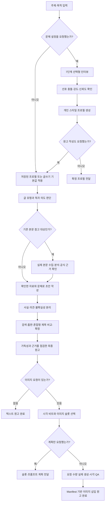
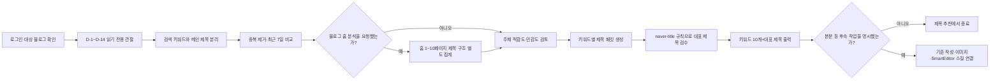
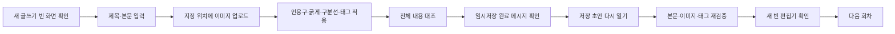

<div align="center">

# 🟢 Naver Blog Style Skill


### 월별 주제 추천·블로그 작성·제목·이미지부터 시리즈·SmartEditor 임시저장까지 연결하는 스킬 모음

<p>
  <a href="./SKILL.md">
    
  </a>
  <a href="./docs/naver-blog-style-profile.md">
    
  </a>
  <a href="./references/choice-question-bank.md">
    
  </a>
  <a href="./references/visual-composition-workflow.md">
    
  </a>
</p>

<p>
  <a href="https://github.com/coreline-ai/naver_blog_skill/commits/main">
    
  </a>
  <a href="https://github.com/coreline-ai/naver_blog_skill">
    
  </a>
  
  
</p>

**문체는 고정하고, 주제만 바꿉니다.**  
말투·리듬·근거 사용법·문단 구조를 프로필로 분리하고, 명시적으로 요청한 경우에만 실사·창작·인포그래픽을 생성해 원고에 배치합니다.

[기능별 사용 가이드](./docs/skill-capabilities.md) · [월별 주제 추천](#naver-seasonal-blog-writer) · [현재 상태](#skill-current-status) · [빠른 시작](#-빠른-시작) · [핵심 기능](#-핵심-기능) · [작동 방식](#-작동-방식) · [이미지 구성](#-visual-composer) · [문답형 작성](#naver-blog-wizard) · [키워드 추천](#naver-creator-keyword-recommender) · [제목 최적화](#-제목-최적화-스킬) · [홈피드 편집](#moneydaeoebi-homepan) · [시리즈 작성](#seo-series-writer) · [SmartEditor 초안](#naver-smarteditor-drafter) · [전체 워크플로](#naver-series-workflow) · [대표 프롬프트](#skill-representative-prompts) · [파일 구조](#-파일-구조) · [사용 예시](#-사용-예시)

</div>

---

<a id="naver-seasonal-blog-writer"></a>

## 월별 시즌 글감과 원고 작성

[naver-seasonal-blog-writer](./skills/naver-seasonal-blog-writer/SKILL.md)는 월별 글감 추천·실제 원고 작성·갱신·블로그별 이력을 담당하는 독립 스킬입니다. 원문 3,109행에서 공백·Unicode 중복을 정리한 2,793개 문구와 보수적인 주제 그룹 2,728개를 포함합니다. 사업명·행사명·교정이 필요한 847개 문구는 검토 대기로 보존하며 자동 추천에서 제외합니다. 최종 추천에서는 같은 질문과 회차가 겹치는지 추가로 검토합니다.

**월만 말하면 그달에 필요한 주제를 자동 추천하고, 선택한 주제로 글을 작성하는 흐름**이 기본입니다. “이번 달 글감 추천해줘”, “3월 주제 추천해줘”만으로 시작하며 “추천한 2번으로 작성해줘”라고 이어서 요청할 수 있습니다. 추천만 요청하면 목록과 이유·가제를 제공하며, 직접 키워드를 준비할 필요가 없습니다.

```text
$naver-seasonal-blog-writer 이번 달에 필요한 블로그 주제 8개를 추천해줘.
$naver-seasonal-blog-writer 3월에 쓸 글감을 추천해줘.
$naver-seasonal-blog-writer 추천한 2번으로 글을 작성하고 출처·검수·이력까지 저장해줘.
```

위 요청은 각각 따로 실행할 수 있습니다. 월을 생략하면 현재 월, 개수를 생략하면 8개를 제안하며, 추천만 요청하면 원고를 작성하지 않습니다. 지정한 번호는 앞서 추천한 주제로 이어집니다. 설치하지 않은 환경에서는 `skills/naver-seasonal-blog-writer/SKILL.md`를 읽고 적용하도록 요청하면 됩니다.

**스킬 폴더 하나로 독립 실행합니다.** 월별 키워드 데이터·추천 도우미·작성 지침·검수·이력 관리가 포함되어 다른 스킬·원본 엑셀·개발 저장소가 필요하지 않습니다. 실행에는 Codex와 Python 3.10+, 최신 공식 자료 확인에는 웹 검색·읽기 도구가 필요합니다. 사용자 원고와 이력은 스킬 밖 작업 공간에 저장합니다. 고정 문체·참고 글 5개·3,000자 조건은 요구하지 않습니다.

2026-10-19에는 사용자 전역 설치와 Codex의 `user / enabled=true` 인식, 설치본으로 월별 추천·실제 원고·이력 저장을 확인했습니다. 월별 추천 보완 후 관련 테스트 33개와 12개월 조회가 통과했습니다. 새 대화에서의 암묵적 자동 선택과 네이버 발행은 별도 미검증입니다. 여기서 자동 추천은 요청한 월의 글감을 자동 선정하는 기능이며 정기 발송 예약은 설정하지 않았습니다.

[월별 추천·작성 사용 가이드](./docs/naver-seasonal-blog-writer-guide.md) · [설치·원고·격리 검증 결과](./docs/seasonal-writer-validation-20261019.md) · [최초 개발 계획](./dev-plan/implement_20261019_145740.md)

## 🧾 본문 표시 품질 보강

이 절은 루트 문체·이미지·SmartEditor 흐름의 표시 기준입니다. 월별 시즌 작성 스킬은 자체 작성 지침에 따라 핵심 주장 가까이에 출처를 연결합니다.

출처는 **말미의 클릭형 출처명**으로 정리하고 같은 URL의 반복·보이는 긴 URL을 준비 단계에서 검사합니다. 명시적인 본문 인용 요청은 `--source-placement inline`으로 존중합니다. 비교표·문단 내부 줄바꿈·독립 문단 간격을 보존합니다.

현재 `smarteditor-layout/v2`는 입력과 임시저장 재열기에서 **네이티브 표 셀 / 링크 href / 명시 개행 / 문단 여백**을 각각 검수합니다. 표를 문장으로 붙이거나 관찰값이 없으면 다음 회차를 시작하지 않습니다. `clipboard_renderer.mjs`는 HTML/text 생성기이며 브라우저나 네이버 UI 호환성을 보증하는 드라이버가 아닙니다.

기존 초안·이미지·실행 이력은 보존합니다. 과거 정책의 성공은 새 표시 품질 검수 완료로 승격하지 않습니다. [작성 가독성 지침](references/article-presentation-quality.md), [실제 입력 런북](skills/naver-smarteditor-drafter/references/smarteditor-runbook.md)을 참고하세요.

## 📌 프로젝트 소개

`naver-blog-style`은 사용자의 취향을 몇 개의 형용사로 요약하는 대신, **실제 글쓰기 행동 규칙**으로 변환하는 네이버 블로그 스타일 스킬입니다.

예를 들어 “친근하고 전문적으로 써줘”를 그대로 사용하지 않습니다. 다음처럼 재사용 가능한 규칙으로 구체화합니다.

> 첫 문단에서 독자가 궁금해할 답을 평이하게 제시하고, 직접 관찰한 차이와 공식 근거를 짧은 문장형 소제목 아래 나눈다. 전문용어는 처음 한 번만 쉽게 풀어쓴다.

주제가 맛집, 제품, 투자, 여행, 앱 리뷰로 바뀌어도 다음 요소는 안정적으로 유지할 수 있습니다.

| 고정되는 스타일 레이어 | 주제에 따라 바뀌는 콘텐츠 레이어 |
|---|---|
| 필자 페르소나와 독자 거리 | 글의 주제와 검색 의도 |
| 감정 온도와 유머 강도 | 사실, 수치, 정책, 가격 |
| 문장 길이와 문단 밀도 | 키워드와 사례 |
| 소제목과 글의 전개 방식 | 이미지와 참고 자료 |
| 근거·의견·불확실성 표현 | 글 유형과 최종 행동 |
| 제목, 강조, CTA 규칙 | 최신 정보와 발행 시점 |

> [!IMPORTANT]
> 이 프로젝트는 검색 순위나 홈피드 노출을 보장하지 않습니다. 완성형 시리즈에는 얇은 초안을 막기 위한 본문 3,000자·이미지 포함 시 최소 3장이라는 제작 하한이 있지만 이를 SEO·승인 공식으로 주장하지 않습니다. 키워드 밀도·해시태그 수·알고리즘 편법 대신 원본 경험·주제 일관성·가독성·투명성을 우선합니다.

## ✨ 핵심 기능

| 기능 | 설명 |
|---|---|
| 🧭 **선택 우선 인터뷰** | 한 번에 한 가지 대비만 질문하고 A~E 선택지로 선호를 구체화합니다. |
| 🧩 **7단계 스타일 분석** | 필자 정체성부터 금지 표현과 샘플 보정까지 순서대로 확인합니다. |
| 🎚️ **강도·신뢰도 관리** | 선택, 선호 강도, 확신 수준, 근거를 분리해 모호한 답을 성급하게 규칙으로 만들지 않습니다. |
| ⚖️ **충돌 감지** | 답변이 충돌하면 임의로 평균내지 않고 대비 질문으로 해결합니다. |
| 🧠 **행동 규칙 추출** | 추상적인 수식어를 문장, 문단, 근거, 제목에 적용할 수 있는 규칙으로 변환합니다. |
| 🗂️ **4단계 규칙 분류** | 스타일을 `always`, `usually`, `optional`, `avoid`로 구분합니다. |
| 📝 **프로필 기반 작성** | 저장된 프로필을 불러와 새로운 주제의 초안과 수정본에 동일한 문체를 적용합니다. |
| 📖 **기존 블로그 본문 참고** | 새 정보형·방법형·비교형 글은 기본 5개 본문에서 검색 의도·공통 내용·빠진 정보를 분석하고 공식 근거로 사실을 확인합니다. |
| 🏷️ **검색·홈판 제목 선정** | 통합 작성에서는 검색형·홈판형·혼합형 각 3개를 내부 비교해 혼합형 제목 1개를 적용하며 명시 조건을 우선합니다. |
| 💬 **문답형 글·이미지 작성** | 글쓰기·이미지 옵션을 한 질문씩 선택하며 원고 검토, 옵션 변경, 중단과 재개를 지원합니다. |
| 📱 **모바일 가독성** | 짧은 문단, 독립 핵심 문장, 필요한 만큼의 목록과 소제목을 사용합니다. |
| 🔎 **사실·의견 분리** | 공식 정보, 개인 관찰, 추천, 불확실한 내용을 구분합니다. |
| 🎨 **문맥 기반 이미지 구성** | 제목·인접 본문·설명 목적에서 슬롯과 장별 프롬프트를 만들고 일반·정보 슬라이드·혼합형을 적용합니다. 이미지 포함 단일 글은 미지정 시 표지 포함 5장, 명시 N은 정확한 완료 수량입니다. |
| 🧾 **Manifest 기반 삽입** | 승인된 로컬 이미지만 명시적 슬롯에 비파괴적으로 삽입합니다. |
| 👁️ **시각 QA** | 문맥, 사실성, 손·얼굴, 글자, 브랜드, 스타일, 모바일 크롭을 확인합니다. |
| 📈 **최근 유입 키워드 추천** | 크리에이터 어드바이저의 완료된 최근 7일을 직전 7일과 비교해 주제를 정하고, 요청 시 블로그 홈 제목 구조를 보완해 대표 제목을 안전하게 추천합니다. |
| 🗞️ **실시간 홈피드 편집** | 실시간 화제어·기사·소재 카드에서 순위 관측과 사건 사실을 분리해 제목·원고·이미지 브리프·성과 진단을 만듭니다. |
| 🧮 **R9 제목 매트릭스** | 홈피드 편집 스킬은 10그룹·50개 후보, 따옴표 20개·무따옴표 30개를 검사하고 서로 다른 그룹의 TOP5와 최종 1개를 선정합니다. |
| 📅 **월별 주제 자동 추천·작성** | 해당 월의 글감을 중복 검토해 추천하고, 선택한 주제로 공식 자료 확인·원고·검수·블로그별 이력 저장까지 독립 수행합니다. |
| 📚 **SEO 시리즈 작성** | 니치·목차·회차별 문제 해결형 원고를 만들고 사실성과 회차 중복을 검수합니다. |
| 🖼️ **기존 원고에 이미지만 추가** | 제목·본문을 유지하며 생성 이미지나 사용자 파일을 배치하고, 기존 이미지의 부분 편집과 표지·본문별 비율 지정을 지원합니다. |
| 🧱 **네이버 정본 준비** | Markdown·구조형 JSON을 `naver-post/v1`으로 변환하고 이미지·태그·서식을 검사합니다. |
| 📐 **실제 표시 품질 검증** | SmartEditor의 네이티브 표·링크·명시 개행·문단 간격을 입력 후와 재열기 후에 각각 확인합니다. |
| ✍️ **안전한 순차 임시저장** | SmartEditor에서 한 편씩 입력·임시저장·재열기·빈 화면 확인 후 다음 회차로 진행합니다. |
| 🔄 **실행 이력·중단 복구** | 원고 버전·이미지 해시·실행 이벤트·작성 잠금을 대조해 재개하고, 저장 후 태그는 본문 변경 없이 읽기 전용으로 확인합니다. |
| 🛡️ **네이버 품질 가드레일** | 키워드 반복, 복제 콘텐츠, 낚시성 제목, 과장 광고, 억지 CTA를 피합니다. |

세부 기능은 [전체 기능표](./docs/skill-capabilities.md#capability-inventory)에 기획·글쓰기·제목, 이미지, 문답·검수·저장·운영으로 나눠 정리했습니다. 각 기능의 실행 범위와 복사해서 사용할 예제도 함께 확인할 수 있습니다.

<a id="skill-current-status"></a>

## 현재 스킬 구성과 검증 상태

**2026-10-23 현재 작업 트리 기준으로 기본 스킬 1개와 전용 스킬 8개, 총 9개가 구현돼 있습니다.** 기능별 기본값, 복사해서 쓰는 예제, 적용 범위는 [기능별 사용 가이드](./docs/skill-capabilities.md)에서 확인할 수 있습니다. 이 환경의 월별 시즌 작성 스킬은 전역 설치까지 확인했으며, 다른 환경의 설치와 GitHub 배포는 별도 작업입니다.

| 스킬 | 담당 범위 | 요청 예시 |
|---|---|---|
| [naver-blog-style](./SKILL.md) | 단일 글 작성·재작성, 문체 프로필, 기존 본문 참고, 제목 선정, 요청한 이미지 완성 | 돈키호테 쇼핑리스트를 카드뉴스 5장과 함께 완성해줘. |
| [naver-blog-wizard](./skills/naver-blog-wizard/SKILL.md) | 단일 글·이미지 옵션 문답, 파일 사용·편집, 선택 변경·중단·재개 | 기존 원고에 이미지만 추가할게. 옵션을 한 질문씩 물어봐. |
| [naver-title](./skills/naver-title/SKILL.md) | 검색형·홈판형·혼합형 제목 생성과 검수 | 네이버 제목 일본 여행 결제수단 비교 |
| [moneydaeoebi-homepan](./skills/moneydaeoebi-homepan/SKILL.md) | 실시간 화제어·기사·소재 카드의 사실 검증, 홈피드 제목·원고·이미지 브리프·성과 진단 | 이 기사로 R9 제목 50개와 TOP5·최종 추천을 만들어줘. |
| [naver-creator-keyword-recommender](./skills/naver-creator-keyword-recommender/SKILL.md) | 실제 최근 유입 기반 주제·대표 제목 추천, 요청한 홈 제목 패턴 분석 | 완료된 최근 7일 유입으로 다음 주제와 대표 제목을 추천해줘. |
| [naver-seasonal-blog-writer](./skills/naver-seasonal-blog-writer/SKILL.md) | 이번 달·지정 월 주제 자동 추천, 선택한 글 작성·갱신·검수·블로그별 이력 관리 | 이번 달 주제 추천 후 선택한 2번으로 작성하고 이력에 남겨줘. |
| [seo-series-writer](./skills/seo-series-writer/SKILL.md) | 연재 목차·회차별 원고 작성·재작성 | 일본 자유여행 준비 5편의 목차와 제1편을 작성해줘. |
| [naver-series-workflow](./skills/naver-series-workflow/SKILL.md) | 여러 편의 원고·이미지·검수 패키지 준비와 명시한 임시저장 연결 | 5편에 회차별 이미지 5장을 넣어 prepare로 준비해줘. |
| [naver-smarteditor-drafter](./skills/naver-smarteditor-drafter/SKILL.md) | 완성 원고 사전검증, 순차 입력·임시저장·재열기 검증 | 검수한 원고와 이미지 5장을 지정 블로그에 넣고 임시저장해줘. |

### 주요 기본값과 실행 범위

| 항목 | 현재 동작 |
|---|---|
| 단일 글 문체·본문 참고 | 저장된 문체 적용. 새 정보형·방법형·비교형은 고유 블로그 본문 5개 참고가 기본이며 1~8개 지정·참고 생략 가능 |
| 통합 글쓰기 제목 | 검색형·홈판형·혼합형 각 3개를 내부 비교해 혼합형 최종 1개 적용. 고정 제목·명시 유형·개수 우선 |
| 제목 전용 일반 / 단축 호출 | 일반은 검색형 5·홈판형 5·혼합형 3개, `네이버 제목/타이틀/주제 …`는 4·3·3개와 최종 추천 |
| R9 홈피드 제목 | 별도 스킬의 10그룹 × 5개 = 50개, TOP5, 최종 1개. 여러 주제도 요청 전체 50개 |
| 이미지 생성 조건·수량 | 요청한 경우에만 생성. 이미지 포함 단일 글의 미지정 수량은 표지 포함 5장, 명시 N은 정확히 N장 |
| 카드뉴스·비율 | 정보 슬라이드는 표지까지 카드뉴스, 혼합형은 일반 표지 + 본문 카드. 슬라이드 기본은 4:5(권장 1080×1350)이며, 정보 슬라이드형 그대로 대표 1:1·본문 16:9 지정 가능. 각 실제 파일을 역할별 비율로 검사 |
| 문답형 선택 | 이미 제공한 답 재사용. 미응답·기본 선택 표시는 답변 확정으로 처리하지 않음 |
| 연재 편수·작성 프로필 | 편수 미지정은 15편 기획과 제1편 작성. 기본 `expert + friendly`, 명시 범위·프로필 우선 |
| 완성형 연재 품질 | 공개 본문 편당 최소 3,000자. 이미지 필수 v2는 표지 1장 + 본문 2장 이상이며 전문가형 미지정 목표는 5장 |
| 실제 유입·월별 추천 | 유입은 오늘 제외 완료 7일 대 이전 7일. 월별 시즌은 현재 월·현재 연도·8개 추천 후 선택한 주제로 작성 |
| 네이버 입력·저장 | 기본 `prepare` 사전검증, 입력·임시저장 요청 시 `draft`. 저장 응답·재열기·다음 글의 빈 화면을 별도로 확인 |
| 태그·발행 | 태그 6개를 필수로 하지 않으며 합성 문자열은 #·공백 포함 100자 이하. 공개·예약 발행은 수행 범위 밖 |

참고 글 수·제목 후보 수·이미지 장수는 독립된 조건이며, 시리즈의 3,000자·이미지 최소 3장을 단일 글에 적용하지 않습니다. 이미지의 혼합형과 제목의 혼합형도 별개입니다. 전체 조건은 [기본값과 적용 범위](./docs/skill-capabilities.md#2-기본값과-적용-범위)를 참고하세요.

최근 구현의 [검증 기록](./dev-plan/implement_20261012_181310.md#phase-4-전체-회귀5개-참고5장-이미지-실검증)은 **Python 274건·Node 28건 통과**, 실제 고유 블로그 본문 5개 참고와 승인된 카드뉴스 5장 생성·본문 삽입을 보고합니다. 이는 이전 구현 검증 기록이며 이번 문서 갱신에서 다시 실행한 테스트 수치가 아닙니다. 문답형의 검증 범위는 [별도 구현 기록](./dev-plan/implement_20261012_151158.md#구현검증-결과)을 참고하세요.

월별 시즌 스킬의 최초 구현에서는 **Python 334개·Node 43개**, 월별 기본 동작 보완 후에는 **관련 테스트 33개**를 통과했습니다. 이 숫자는 각 구현 단계의 실행 기록이며 이번 문서 수정에서 전체 회귀를 다시 실행한 수치는 아닙니다. [검증 결과](./docs/seasonal-writer-validation-20261019.md)에 실행 범위를 구분했습니다.

2026-10-21의 로컬 실행 기록에는 **단일 글 1편·이미지 5장(대표 1:1, 본문 16:9)·표 3개·출처 링크 8개**의 실제 임시저장·재열기·새 빈 화면 검증이 남아 있습니다. [실행 범위와 근거](./docs/skill-capabilities.md#smarteditor-live-validation)를 참고하세요.

2026-10-23에는 M5 울트라 신규 원고로 **정보 슬라이드형 대표 1:1·본문 16:9의 최종 5장 생성·검수·본문 삽입·ZIP 재검사**를 완료했습니다. 데스크톱 375px 표시에서 본문 글씨를 확인하고 각 본문 카드에 1회 가독성 보정을 적용했습니다. 이후 사용자 요청으로 어사이드에서 **이미지 5장·표 2개·링크 5개를 임시저장하고 재열기 검증**까지 완료했습니다. [실제 생성·저장 검증 결과](./docs/m5-ultra-slide-validation-20261023.md)에 범위와 근거를 기록했습니다.

이미지 패키지의 로컬 검사와 실제 생성·시각 검수는 구분합니다. 별도 물리 휴대폰 검수와 새 대화의 암묵적 스킬 선택은 아직 확인하지 않았습니다. SmartEditor는 로그인·관찰·업로드 도구를 확인한 실행에서 임시저장까지만 수행하며, 로컬 테스트 통과를 실제 네이버 저장 성공으로 표시하지 않습니다.

## 🚀 빠른 시작

### 1. 저장소 복제

```bash
git clone https://github.com/coreline-ai/naver_blog_skill.git
cd naver_blog_skill
```

### 2. 핵심 파일 확인

```bash
cat SKILL.md
cat docs/naver-blog-style-profile.md
```

### 3. 에이전트에게 프로필 적용 요청

저장소를 작업 폴더로 연 뒤 다음처럼 요청합니다.

```text
SKILL.md의 네이버 블로그 스타일 스킬을 적용해줘.
docs/naver-blog-style-profile.md에 저장된 프로필을 먼저 로드하고,
주제 "[작성할 주제]"로 네이버 블로그 글을 작성해줘.
```

### 4. 새로운 프로필 만들기

```text
이 저장소의 네이버 블로그 스타일 인터뷰를 시작해줘.
한 번에 질문 하나씩 진행하고, 완료된 프로필은 기존 파일을 덮어쓰기 전에 변경안을 보여줘.
```

### 5. 이미지가 포함된 글 만들기

주제·이미지 유형·장수·완성을 한 번에 요청할 수 있습니다. 아래 요청은 원고 작성 후 **표지 포함 정보 슬라이드 5장을 실제 생성·검수하고 본문에 넣는 작업**으로 처리합니다. 내부 원고 파일과 슬롯 JSON은 에이전트가 준비합니다.

```text
주제: 한국인 여행객 장바구니에서 가장 높은 비중을 차지하는 돈키호테 인기 품목을 카테고리별로 정리
정보 슬라이드 / 카드뉴스형 5장으로 네이버 블로그 스킬을 이용해서 완성해줘!
```

구매 비중·인기 순위는 해당 주장의 실제 출처를 확인하고 근거가 없으면 수치나 순위를 만들지 않습니다. `정보 슬라이드/카드뉴스형`은 표지까지 모두 슬라이드이며, **이미지 유형을** `혼합형`으로 지정할 때만 표지가 일반 이미지입니다. 제목의 혼합형 전략은 이미지 유형을 바꾸지 않습니다. 이미지 포함 단일 글의 장수 미지정은 총 5장, 명시한 장수는 그 수량을 우선합니다. 시리즈는 기존 작성 프로필의 미지정 목표를 유지합니다. `프롬프트만` 또는 `이미지는 생성하지 마`라고 하면 계획에서 끝냅니다.

자세한 흐름과 완료 기준은 [주제부터 이미지 포함 원고 완성](./references/topic-image-completion-workflow.md)을 참고하세요. 저장소 직접 사용은 SKILL.md를 읽어 적용하고, 설치·등록된 환경에서는 `$naver-blog-style`로도 호출할 수 있습니다. 이 저장소의 메타데이터 추가 자체가 전역 설치를 수행하지는 않습니다.

### 기존 블로그 본문 참고

새 정보형·방법형·비교형 글은 기본적으로 **네이버 블로그 서비스 검색의 기존 글 5개 본문**을 참고합니다. 검색 요약과 실제 본문을 구분해 수집하고, 공통 검색 의도·설명·빠진 정보를 분석한 뒤 공식 자료로 사실을 확인해 새 원고를 작성합니다. 다른 작성자의 경험을 자신의 경험으로 쓰거나 반복 언급을 공식 인기 순위로 바꾸지 않습니다.

참고 수는 1~8개이며 **이미지 장수·제목 후보 수와 별개**입니다. `네이버 검색 결과를 참고`는 통합 블로그 검색, 미지정은 블로그 서비스 검색입니다. `기존 글은 참고하지 마`를 우선하고, 재작성은 검색 보완 명시 시에만 적용합니다. 개인 경험 후기·일기·문체 인터뷰는 명시 참고 요청만 적용합니다. 제목/이미지 전용 요청의 원고를 조사·재작성하지 않습니다.

```text
돈키호테 쇼핑리스트를 기존 네이버 블로그 글 3개의 본문을 참고해 작성하고,
공식 자료로 확인한 뒤 정보 슬라이드 5장으로 완성해줘.

기존 블로그 글은 참고하지 말고 제공한 자료만으로 네이버 블로그 글을 작성해줘.
```

실제 참고 수·부분 실패·잘린 문맥을 따로 기록합니다. 명시한 N개 본문이 부족하면 참고 요구를 충족한 완료로 표시하지 않습니다. 기본 5개의 부분 결과는 확보한 범위를 밝히고 사용할 수 있습니다. [수집·분석 흐름](references/blog-research-workflow.md), [입출력 계약과 CLI](references/blog-research-contract.md)를 참고하세요. 로컬 도우미는 JSON·길이·중복·상태를 검사하며 브라우저 수집·의미 분석·이미지 생성은 현재 에이전트가 수행합니다.

```text
저장된 스타일 프로필로 주제 "[작성할 주제]"의 글을 작성해줘.
사실 확인이 끝난 원고를 기준으로 대표 이미지와 필요한 본문 이미지를 만들어줘.
실사·창작·인포그래픽은 소제목의 문맥과 분위기에 맞게 선택하고,
검수에 통과한 이미지만 원고 중간에 넣어줘.
```

### 6. 시리즈를 SmartEditor 임시저장까지 연결

처음에는 브라우저를 건드리지 않는 `prepare`로 검사하고, 통과 결과를 확인한 뒤 `draft`를 별도로 요청하는 방식을 권장합니다.

```text
이 저장소의 skills/naver-series-workflow/SKILL.md를 읽고 적용해줘.
[시작 회차]부터 [종료 회차]까지 원고·이미지·태그를 먼저 prepare 해줘.
이번 단계에서는 SmartEditor를 조작하지 마.
```

준비가 끝나면 대상 URL을 지정합니다.

```text
검수가 완료된 회차를 아래 SmartEditor에 한 편씩 임시저장해줘.
각 편을 다시 열어 검증하고 새 빈 화면 확인 후 다음 편으로 진행해줘.
공개 발행과 예약 발행은 하지 마.

대상: https://blog.naver.com/블로그아이디?Redirect=Write&categoryNo=카테고리번호
```

자세한 모드, 재개 방법과 서식 매핑은 [SEO 시리즈 전체 워크플로 사용법](#naver-series-workflow)을 참고하세요.

> [!TIP]
> 이미 프로필이 있다면 인터뷰를 반복할 필요가 없습니다. 프로필 파일을 먼저 로드하고 주제, 글 유형, 독자 의도만 전달하면 됩니다.

<a id="naver-blog-wizard"></a>

## 네이버 블로그 문답형 글·이미지

[naver-blog-wizard](skills/naver-blog-wizard/SKILL.md)는 단일 글 작성과 이미지 설정을 한 질문씩 확인합니다. 이미 알려준 옵션은 건너뛰고, 앞선 선택 변경·중단·재개를 지원합니다.

```text
$naver-blog-wizard 주제는 실내 식물 관리야. 글쓰기와 이미지 옵션을 한 번에 하나씩 질문하면서 진행해줘.
```

| 선택 경로 | 결과 |
|---|---|
| 글만 | 사용 선택된 원고 |
| 프롬프트만 | 이미지 계획·프롬프트 |
| 이미지 생성 / 내 파일 | 실제 파일 검사·시각 검수·이미지 포함 원고 |
| 기존 이미지 편집 | 원본을 사용한 편집 결과, 원고 연결 시 합성까지 |

이미지 유형은 일반·정보 슬라이드·혼합형이며 장수는 표지 포함 총 N장입니다. 자동 선택은 추천 5장을 확인한 뒤 적용합니다. info-slide는 표지까지 슬라이드, mixed는 일반 표지 1장과 슬라이드 N-1장입니다. 단일 글에 시리즈 15편·3,000자·최소 3장을 적용하지 않습니다.

전체 저장소의 공통 scripts·sibling 스킬이 필요하며 하위 폴더만 복사하는 설치는 지원하지 않습니다. 실행 환경은 Python 3.11+, macOS/Linux와 기존 Pillow입니다. PyYAML은 스킬 메타데이터 검사 도구에 필요하며 런타임에는 사용하지 않습니다. 사용자 파일은 선택한 작업 영역의 `naver-blog-output/SESSION-ID/`에 보관합니다. 네이버 입력·임시저장·발행은 별도 흐름입니다.

```sh
python3.11 -B skills/naver-blog-wizard/scripts/wizard_session.py init --work-root /absolute/user/workspace
python3.11 -B skills/naver-blog-wizard/scripts/wizard_session.py next --session /absolute/user/workspace/naver-blog-output/SESSION-ID/session.json
python3.11 -B skills/naver-blog-wizard/scripts/wizard_session.py pause --session /absolute/user/workspace/naver-blog-output/SESSION-ID/session.json --expected-revision N
python3.11 -B skills/naver-blog-wizard/scripts/wizard_session.py resume --session /absolute/user/workspace/naver-blog-output/SESSION-ID/session.json --expected-revision N
```

세션 명령·산출물 등록은 [세션 계약](skills/naver-blog-wizard/references/session-contract.md)을 따릅니다. 결과가 불명확한 이미지 작업은 실제 반환 파일을 먼저 대조하며 자동 중복 생성하지 않습니다. 로컬 패키지 검증 통과는 실제 생성·시각 QA를 대신하지 않습니다.

## 🔄 작동 방식



이 흐름도는 단일 원고 작성 기준입니다. 기존 이미지 편집은 확인한 원본으로 편집하고, 제목만·문답형·시리즈·네이버 입력 요청은 [기능별 담당 스킬](./docs/skill-capabilities.md#1-어떤-스킬을-사용할까)로 연결합니다.

### 인터뷰 7단계

| 단계 | 확인하는 내용 | 대표 결과 |
|---:|---|---|
| 1/7 | 필자 정체성과 독자 관계 | 페르소나, 독자와의 거리, 제공 가치 |
| 2/7 | 분위기, 감정 온도, 유머 | 밝기, 진지함, 농담, 비판 강도 |
| 3/7 | 문장 끝맺음, 단어, 리듬 | 존댓말, 문장 길이, 접속어, 강조법 |
| 4/7 | 문단, 소제목, 글의 흐름 | 도입, 전개, 결론, 목록 사용 |
| 5/7 | 근거, 의견, 비판, 불확실성 | 출처, 균형, 단정 수준, 숫자 사용 |
| 6/7 | 제목, 이미지, 링크, CTA | 제목 자극성, 캡션, 행동 요청 |
| 7/7 | 금지 패턴과 샘플 보정 | 피해야 할 말투, 사용자 샘플 기반 교정 |

질문 은행에는 최대 39개의 보정 문항이 들어 있지만, 모든 질문을 기계적으로 묻지 않습니다. 이미 확인된 항목은 건너뛰고 불확실한 대비만 추가로 질문합니다.

## 👤 현재 포함된 스타일 프로필

현재 [`docs/naver-blog-style-profile.md`](./docs/naver-blog-style-profile.md)에는 35개 인터뷰 응답을 바탕으로 만든 프로필이 포함되어 있습니다.

> **공감할 수 있는 상황에서 시작해, 쉽고 재미있게 새로운 관점을 보여주고, 공식 근거와 균형 잡힌 비교로 독자의 판단을 돕는 관찰형 리뷰어 스타일**

### 프로필 요약

| 영역 | 적용 방식 |
|---|---|
| 🗣️ 필자와 독자 | 관찰력 좋은 리뷰어, 적당히 친근한 존댓말 |
| ☀️ 분위기 | 밝고 활기차되 감정 표현은 절제 |
| 😄 유머 | 짧은 자조와 소소한 농담을 가끔 사용 |
| ✍️ 문장 | 핵심은 짧게, 중요한 설명은 충분히 작성 |
| 📱 문단 | 모바일에서 읽기 쉬운 짧은 문단 |
| 🧲 소제목 | 목차형보다 궁금증을 만드는 문장형 |
| 🔍 근거 | 공식 자료와 출처를 적극 활용하고 글 마지막에 정리 |
| ⚖️ 평가 | 장단점을 균형 있게 보여주고 선택을 강요하지 않음 |
| 🏷️ 제목 | 검색 주제와 읽을 이유를 구체적으로 제시. 목적별 선택, 기본 혼합형 |
| ✅ 마무리 | 바로 활용할 수 있는 팁이나 체크리스트 |

### 규칙 우선순위

| 분류 | 의미 | 현재 프로필의 예 |
|---|---|---|
| `always` | 항상 지켜야 하는 핵심 규칙 | 쉬운 표현, 짧은 모바일 문단, 사실과 의견 구분 |
| `usually` | 특별한 이유가 없으면 적용 | 밝은 리듬, 문장형 소제목, 마지막 체크리스트 |
| `optional` | 글에 어울릴 때만 소량 사용 | 이모지, 질문, 짧은 실패담, 수미상관 |
| `avoid` | 명시적으로 피해야 하는 패턴 | 근거 없는 단정, 과장 광고, 키워드 반복, 억지 CTA |

## 🧰 지원하는 글 유형

핵심 문체는 유지하되 글의 목적에 맞게 전개만 조정합니다.

| 유형 | 권장 흐름 |
|---|---|
| 🔍 **리뷰** | 기대 또는 상황 → 실제 관찰 → 장점과 단점 → 적합한 독자 |
| 🧭 **가이드** | 독자의 문제 → 핵심 답변 → 단계별 설명 → 체크리스트 |
| 📓 **경험 기록** | 구체적인 상황 → 변화나 발견 → 개인적인 판단 → 활용 팁 |
| 📢 **공지** | 바뀐 내용 → 적용 시점 → 대상 → 필요한 행동 |
| ⚖️ **비교** | 비교 기준 → 차이 → 장단점 → 상황별 선택 기준 |
| 🔗 **홍보·링크** | 유용한 정보 → 투명한 관계 고지 → 링크 → 과장 없는 안내 |

## 🎨 Visual Composer

Visual Composer는 사용자가 대표 이미지, 본문 이미지, 이미지 삽입을 명시적으로 요청했을 때만 실행됩니다. 일반 글쓰기 요청에서는 이미지 생성 도구를 호출하지 않습니다.

### 실행 모드

| 모드 | 요청 예시 | 출력 |
|---|---|---|
| `plan-only` | “이미지 위치와 프롬프트만 제안해줘” | 슬롯 계획, 프롬프트, alt, caption |
| `generate-and-compose` | “대표 이미지와 본문 이미지를 만들어 넣어줘” | 이미지 파일, JSON manifest, 이미지 포함 Markdown |
| `edit-existing` | “이 사진의 배경만 바꿔줘” | 기존 대상을 보존한 편집 이미지 |

### 이미지 유형 선택

| 글의 문맥 | 기본 유형 |
|---|---|
| 구체적인 사람·장소·제품·일상 상황 | `photorealistic-natural` |
| 시간·절차·비교·체크리스트 | `infographic-diagram` |
| 감정·관점·변화·추상적인 메시지 | `stylized-concept` |
| 비운영 목적의 일반 인터페이스 개념 | `ui-mockup` |

일반 이미지 구성은 수량을 SEO 공식으로 고정하지 않습니다. 다만 `naver-series/v2` 이미지 포함 완성형은 표지만 있는 패키지를 막기 위해 대표 1장과 본문 2장, 총 최소 3장을 제작 하한으로 사용합니다. 모든 소제목을 채우기보다 독자가 상황을 이해하기 어렵거나 정보 구조가 크게 바뀌는 지점을 선택합니다.

### 출력 구조

```text
assets/<post-slug>/
├── 01-cover.png
├── 02-section-context.png
├── 03-section-guide.png
├── article.md
├── image-manifest.json
└── article-with-images.md
```

`image-manifest.json`에는 이미지 목적, 위치, 생성 모드, 프롬프트, 대체텍스트, 캡션, 경로, 승인 상태가 기록됩니다. 원고에는 `<!-- naver-image:<slot-id> -->` 마커를 사용합니다.

승인된 이미지를 삽입하려면 프로젝트 루트에서 다음 명령을 실행합니다.

```bash
python3.11 scripts/insert_article_images.py \
  --article assets/<post-slug>/article.md \
  --manifest assets/<post-slug>/image-manifest.json \
  --out assets/<post-slug>/article-with-images.md
```

기본 실행은 원본과 기존 출력 파일을 덮어쓰지 않습니다. 기존 출력 교체가 명시적으로 필요할 때만 `--force`를 사용합니다.

> [!WARNING]
> 앱 조작법, 금융 주문, 정책 신청처럼 화면 정확성이 중요한 경우 생성형 UI를 사용하지 않습니다. 사용자 캡처나 공식 자료를 우선하고, 생성 실사가 실제 경험의 증거로 오해될 수 있으면 캡션에서 이해를 돕기 위한 이미지임을 밝힙니다.

상세 규칙: [시각 구성 흐름](./references/visual-composition-workflow.md) · [이미지 모드](./references/image-generation-modes.md) · [Manifest v1](./references/image-slot-manifest.md)

### 본문 기반 이미지 프롬프트 도우미

[`build_blog_image_prompts.py`](./scripts/build_blog_image_prompts.py)는 원고와 확정된 이미지 슬롯을 읽어 장별 목적·본문 문맥·슬라이드 제목·요점·제작 기준을 조립합니다. `sns_content_writer`의 계산을 이식했으며 실행 시 원본 프로젝트나 브라우저가 필요하지 않습니다. 입력/출력과 원본 대비 차이는 [프롬프트 계약](./references/blog-image-prompt-contract.md)에 정리되어 있습니다.

| 표현 유형 | 동작 |
|---|---|
| `standard` | 소제목의 상황에 맞춰 이미 정한 실사·삽화·도해 연출을 유지 |
| `info-slide` | 본문 근거에서 제목·요점을 추출하는 정보 슬라이드. 기본 4:5이며 대표 1:1·본문 16:9도 지정 가능 |
| `mixed` | 대표는 일반 이미지, 본문은 정보 슬라이드 |

한국어가 기본이며 `language: en`은 원본의 영문 빌더를 사용합니다. 요청 장수는 기존 슬롯의 앞 N개를 선택하고 본문을 N개로 다시 요약·분배하지 않습니다. 명시 슬롯의 ID·순서와 시리즈 최소/목표 계약은 유지합니다. 부족한 슬롯·참고 파일·원고 버전 변경은 진단으로 보고합니다.

정보 슬라이드도 **대표 1:1·본문 16:9**로 구성할 수 있습니다. 요청 JSON의 선택 `aspect_ratios: {"cover":"1:1","inline":"16:9"}`를 프롬프트·실제 파일 검사에 동일하게 적용하며 표지는 계속 정보 슬라이드입니다. 허용 비율은 4:5·1:1·16:9, 지정하지 않은 슬라이드는 기존 4:5를 유지합니다. 문답형에서도 최초 요청·비율 조건 변경으로 지정할 수 있습니다. [개발 계획과 검증 결과](./dev-plan/implement_20261023_153352.md)를 참고하세요.

```text
네이버 블로그 스킬로 일본 여행 준비 글을 완성해줘.
정보 슬라이드형 5장으로, 대표 1장은 1:1, 본문 4장은 16:9로 만들어줘.
실제 이미지를 생성·검수해서 본문에 삽입해줘.
```

다음 예시는 짧은 시험 원고로 **프롬프트 계획만** 확인합니다.

```bash
python3.11 -B scripts/build_blog_image_prompts.py \
  --input tests/fixtures/blog-image-prompts/request-mixed.json \
  --project-root "$PWD" --check
```

계획을 저장하려면 `--check` 대신 `--output output/image-plan-01.json`을 지정합니다. 기존 출력 파일은 교체하지 않으므로 새 이름을 사용합니다. 실제 생성 도구에는 각 항목의 `prompt`와 확인된 참고 파일을 전달합니다. 생성·시각 QA가 끝난 후 manifest v1의 기존 `prompt` 필드에는 한 줄 보관값 `manifest_prompt`를 넣고 실제 파일 경로·캡션·승인 상태를 채웁니다. 계획의 `planned`는 생성·승인·시리즈 입력 준비를 의미하지 않습니다.

완성 요청에는 `--operation generate-and-compose`를 명시합니다. `design_slots`이면 요청 수량의 구체 장면을 설계해 다시 검사하고, `generate_images`이면 현재 이미지 도구로 바로 이어갑니다. 실제 승인 파일과 이미지 포함 원고가 만들어진 후 원본 요청 JSON으로 최종 패키지를 대조할 수 있습니다.

```bash
python3.11 -B scripts/build_blog_image_prompts.py \
  --input drafts/image-request.json --project-root "$PWD" \
  --operation generate-and-compose \
  --manifest drafts/image-manifest.json \
  --composed-article drafts/article-with-images.md --check
```

요청 5장에 최종 이미지가 4장 또는 6장인 경우, 중복 파일·미승인·잘못된 비율·유형/프롬프트/본문 불일치가 있으면 `incomplete`입니다. `package_verified`는 실제 파일과 합성을 대조한 결과이며 모델 실행과 눈으로 확인한 시각 QA는 별도 근거가 필요합니다. 프롬프트 준비에서 멈추거나 수량 미달을 이미지 포함 완성으로 보고하지 않습니다.

```text
SKILL.md의 시각 모드를 적용해 drafts/article.md에 필요한 이미지 슬롯을 먼저 설계해줘.
각 슬롯을 해당 문단의 구체적인 상황과 설명 목적에 연결하고,
공통 프롬프트 도우미로 혼합형 3장의 계획과 프롬프트만 만들어줘.
이미지 생성은 하지 마.
```

```text
SKILL.md의 시각 모드를 적용해 drafts/article.md의 소재 비교 문단을
한국어 정보 슬라이드 1장으로 만들어줘.
본문에서 제목과 요점을 추출하고 실제 생성 결과의 문구·비율·가독성을 검수해줘.
```

## 💬 사용 예시

<a id="skill-representative-prompts"></a>

### 스킬별 대표 프롬프트

아래 예시는 설치·등록된 환경의 `$스킬명` 호출입니다. 저장소 직접 사용에서는 해당 `SKILL.md`를 읽어 적용하도록 요청하고 대괄호 안의 값만 바꾸면 됩니다. SmartEditor 관련 스킬의 실행 범위는 임시저장·재검증까지이며 공개·예약 발행은 수행하지 않습니다. 단일 글의 참고 수·제목 유형·이미지 장수별 예제는 [기능별 사용 가이드](./docs/skill-capabilities.md)를 참고하세요.

#### 1. `naver-blog-style` — 저장된 문체로 단일 글 작성

```text
$naver-blog-style

docs/naver-blog-style-profile.md의 저장된 문체를 적용해
주제 "[작성할 주제]"로 네이버 블로그 글을 작성해줘.

조건:
- 첫 문단에서 독자의 핵심 질문에 답하기
- 사실·개인 의견·추천을 구분하기
- 모바일에서 읽기 쉬운 짧은 문단으로 구성하기
- 확인되지 않은 경험이나 수치를 만들지 않기
- 이미지 생성과 게시 작업은 하지 않기
```

#### 2. `naver-creator-keyword-recommender` — 최근 유입 기반 키워드와 제목 추천

```text
$naver-creator-keyword-recommender

최근 완료된 7일 데이터를 직전 7일과 비교해서
내 블로그에 적합한 키워드 10개를 추천해줘.

검색 유입에서는 글의 주제를 선정하고,
메인 유입에서는 제목 원문을 복사하지 말고 패턴만 분석해
각 키워드의 대표 추천 제목을 1개씩 만들어줘.

본문·이미지·SmartEditor 작업은 하지 마.
```

블로그 홈의 현재 제목 구조까지 선택적으로 반영하려면 다음처럼 요청합니다.

```text
$naver-creator-keyword-recommender

최근 완료된 7일 검색 유입을 직전 7일과 비교해
내 블로그에 맞는 키워드 10개를 추천해줘.
네이버 블로그 홈 1~10페이지는 원문을 복사하지 말고 제목 패턴만 분석해
각 키워드의 대표 추천 제목을 1개씩 만들어줘.

본문·이미지·SmartEditor 작업은 하지 마.
```

이 요청은 `recommend-with-home` 모드로 처리됩니다. 실행 결과에는 다음 내용만 포함됩니다.

1. 최근 7일과 직전 7일의 수집 범위·완료 상태
2. 검색 유입을 근거로 선정한 키워드 10개
3. 각 키워드의 관찰 근거와 추세 분류
4. 메인 유입과 블로그 홈의 집계 패턴을 반영한 대표 제목 1개
5. 부분 수집, 시의성, 사실 확인 필요 여부 등의 주의사항

검색 유입은 **무엇을 쓸지** 정하는 데 사용하고, 메인 유입과 블로그 홈은 **어떻게 제목을 구성할지** 판단하는 데만 사용합니다. 다른 게시물의 제목 원문이나 고유 문구를 결과에 노출하지 않으며, 확인되지 않은 숫자·인용문·경험도 새 제목에 만들지 않습니다. 최신 날짜의 일부 데이터가 지연되면 결과를 `partial`로 표시하고 상승·신규 키워드로 단정하지 않습니다.

요청문에 `본문·이미지·SmartEditor 작업은 하지 마`가 있으면 키워드와 대표 제목을 출력한 뒤 종료합니다. 이후 작업은 자동으로 이어지지 않습니다.

#### 3. `naver-title` — 검색형·홈판형·혼합형 제목 만들기

```text
$naver-title

주제 "[핵심 주제]"와 검색 의도 "[독자가 해결하려는 문제]"를 기준으로
검색형 4개, 홈판형 3개, 혼합형 3개를 만들어줘.

후보를 사실성·키워드 반복·클릭베이트 기준으로 검수하고
최종 추천 제목 1개를 골라줘.
확인되지 않은 가격·기간·경험은 만들지 마.
```

#### 4. `moneydaeoebi-homepan` — 실시간 화제어를 홈피드 콘텐츠로 편집

```text
$moneydaeoebi-homepan

현재 화제어를 확인하고 R9 10그룹·50개 제목 매트릭스와 TOP5·최종 추천을 만들어줘.
화제어 집계 출처와 확인 시각을 밝히고,
검색어 관측과 사건 사실을 서로 다른 근거로 검증해줘.
```

#### 5. `seo-series-writer` — 정보성 시리즈 기획과 제1편 작성

```text
$seo-series-writer

주제 "[시리즈 주제]"로 [원하는 편수]편의 SEO 정보성 시리즈를 기획해줘.
먼저 전체 목차와 제1편 본문을 작성하고,
이후에는 요청할 때 한 편씩 이어가줘.

조건:
- 각 편은 서로 다른 검색 의도와 문제를 해결하기
- 완성형 게시 본문은 제목·태그·참고 URL·이미지 정보를 제외하고 3,000자 이상 작성하기
- 별도 지정이 없으면 전문가형을 중심으로 친숙하게 설명하기
- 근거 없는 체험·실험·수치를 만들지 않기
- 계산·진단표·비교표·절차·체크리스트 중 주제에 맞는 실용 자료를 포함하기
- 적용 한계와 예외 조건을 설명하기
- 핵심 요약과 다음 편 예고를 포함하기
- 이미지 생성과 게시 작업은 하지 않기
```

#### 6. `naver-smarteditor-drafter` — 완성 원고 검증과 순차 임시저장

```text
$naver-smarteditor-drafter

완성된 원고 경로 "[절대 경로]"를 naver-post/v1 형식으로 사전검증해줘.
검증을 통과하면 지정한 네이버 SmartEditor에 한 편씩 입력하고 임시저장해줘.

조건:
- 이미지 순서는 원고의 이미지 블록 순서를 유지하기
- H2는 말풍선형 인용구, 핵심 요약은 라인형 인용구로 적용하기
- 임시저장 후 다시 열어 내용과 다음 빈 편집기 전환을 확인하기
- 공개·예약 발행은 하지 않기
```

#### 7. `naver-series-workflow` — 시리즈 전체를 안전하게 준비

```text
$naver-series-workflow

현재 프로젝트의 [시작 회차]부터 [종료 회차]까지
네이버 블로그용 실행 패키지를 prepare 모드로 준비해줘.

조건:
- 신규 완성형은 naver-series/v2로 준비하기
- 회차별 게시 본문 3,000자, 작성 프로필, 이미지, 태그, naver-post/v1 정본을 검증하기
- 이미지 포함 요청이면 각 편에 대표 1장과 본문 2장 이상, 총 최소 3장을 사용하기
- 전문가형에서 이미지 수를 지정하지 않으면 목표 5장으로 준비하기
- 태그는 #과 공백을 포함해 100자 이내로 검사하기
- 구조·길이·편집·시각·입력 준비 상태와 다음 실행 지점을 분리해 생성하기
- 이번 요청에서는 SmartEditor 입력과 발행을 하지 않기
```

#### 8. `naver-blog-wizard` — 한 질문씩 글·이미지 옵션 선택

```text
$naver-blog-wizard

주제는 일본 여행 전 준비할 결제수단이야.
대상 독자·글 유형·말투·이미지 옵션을 한 질문씩 선택하게 해줘.
이미 답한 옵션은 유지하고, 원고 검토부터 이미지 포함 완성까지 진행해줘.
```

문답 중에는 `이미지 유형만 카드뉴스형으로 바꿔줘`, `잠시 중단해줘`, `이전 세션을 이어서 진행해줘`처럼 범위를 지정할 수 있습니다. 문체 인터뷰·시리즈 작성·SmartEditor 입력은 각각 별도 스킬의 범위입니다.

#### 9. `naver-seasonal-blog-writer` — 월별 주제 추천 후 선택한 글 작성

```text
$naver-seasonal-blog-writer
이번 달에 필요한 블로그 주제 8개를 중복 없이 추천해줘.
추천 이유·가제·작성 시점·확인할 핵심 사실도 알려줘.
```

```text
$naver-seasonal-blog-writer
추천한 2번 주제로 초보자를 위한 글을 작성해줘.
최신 공식 자료를 확인하고 원고·출처·검수 결과와 myblog 작성 이력을 저장해줘.
```

월만 지정한 추천과 실제 글쓰기를 나누어 요청할 수 있습니다. “3월 주제 추천”, “다음 달 생활정보 5개”, “12월 월간 계획”도 지원합니다. 독립 실행 조건·날짜 해석·저장 파일은 [전용 가이드](./docs/naver-seasonal-blog-writer-guide.md)를 참고하세요.

#### 10. 전체 워크플로 — 최근 키워드 선정부터 글 3편 임시저장까지

아래 프롬프트는 `naver-creator-keyword-recommender` → `naver-title` → `naver-blog-style` 또는 `seo-series-writer` → `naver-series-workflow` → `naver-smarteditor-drafter`를 하나의 안전한 작업으로 연결하는 대표 예시입니다.

```text
$naver-series-workflow

로그인된 네이버 크리에이터 어드바이저에서 오늘을 제외한
최근 완료 7일 데이터를 직전 7일과 비교해줘.

검색 유입 데이터는 내 블로그에 적합한 글 주제와 키워드를 찾는 데 사용하고,
메인 유입 콘텐츠는 원문을 복사하지 말고 제목 구조와 호기심 패턴만 분석해줘.
키워드 10개와 키워드별 대표 추천 제목 1개를 먼저 만들고,
적합도·근거 충분성·중복 위험을 검토해 상위 3개를 선택해줘.

선택한 주제로 서로 독립적인 정보성 글 3편을 작성해줘.
저장된 문체 프로필이 있으면 적용하고, 없으면 범용 정보성 문체를 사용해줘.

작성 조건:
- 제목과 본문이 해결하는 질문을 일치시키기
- 게시 본문은 제외 영역을 빼고 3,000자 이상 작성하기
- 전문가형을 primary, 친숙한 설명형을 secondary로 적용하기
- 확인되지 않은 경험·수치·가격·일정은 만들지 않기
- 사실·의견·추천·변동 가능 정보를 구분하기
- 조건부 예제, 실전 절차, 진단·비교 도구, 적용 한계를 포함하기
- 모바일에서 읽기 쉬운 짧은 문단과 소제목 사용하기
- 태그는 #과 공백을 포함해 100자 이내로 만들기
- 글마다 정보 가치가 있는 이미지 5장의 위치를 먼저 설계하기
- 최종 원고를 기준으로 이미지를 생성·시각 QA하고 승인 파일만 사용하기

세 글을 naver-post/v1으로 변환하고 사전검증과 콘텐츠 검수를 완료한 뒤,
아래 SmartEditor에 한 편씩 순차 입력해 임시저장해줘.

대상 SmartEditor:
[https://blog.naver.com/블로그아이디?Redirect=Write&categoryNo=카테고리번호]

SmartEditor 규칙:
- H2 소제목은 인용구 3 말풍선형으로 적용하기
- 핵심 요약과 마무리 라벨은 인용구 2 라인형으로 적용하기
- 이미지 5장이 정본에 지정된 위치와 순서대로 들어갔는지 확인하기
- 굵게 강조와 태그가 정본과 일치하는지 확인하기
- 각 글은 임시저장 완료 메시지를 확인한 뒤 저장된 초안을 다시 열어 검증하기
- 새 글쓰기 빈 화면을 확인한 뒤에만 다음 글로 진행하기
- 기존 글과 기존 임시저장 글은 삭제하지 않기
- 공개 발행과 예약 발행은 절대 하지 않기

마지막에는 키워드 선정 결과, 선택한 제목 3개,
글별 임시저장 확인 여부와 재열기 검증 결과만 요약해줘.
```

이 프롬프트를 실행하면 다음 순서로 동작합니다.

1. 최근 7일과 직전 7일의 검색 유입을 읽기 전용으로 비교합니다.
2. 메인 유입 제목에서는 문구가 아니라 구조만 추출합니다.
3. 키워드 10개와 대표 제목을 만들고 상위 3개를 선택합니다.
4. 글 3편을 3,000자 이상으로 작성하고 질문 해결·프로필 적합성·구체성·태그·사실성·중복을 검사합니다.
5. 최종 원고에서 이미지 슬롯을 정하고 글마다 이미지 5장을 생성·검수합니다.
6. 원고와 승인 이미지를 `naver-post/v1` 정본으로 변환해 사전검증합니다.
7. SmartEditor에 첫 글과 이미지를 입력하고 임시저장한 뒤 다시 열어 확인합니다.
8. 빈 편집기를 확인한 후 같은 절차로 다음 글을 진행하고 공개 발행 없이 종료합니다.

> 키워드 탐색부터 원고 준비까지 연결하려면 `naver-creator-keyword-recommender` → `naver-title` → `seo-series-writer` → `naver-series-workflow` 순서로 사용할 수 있습니다. 필요한 단계만 독립적으로 호출해도 됩니다.

<details>
<summary><strong>예시 1 — 저장된 프로필로 새 글 작성</strong></summary>

```text
저장된 네이버 블로그 스타일 프로필을 로드해줘.
주제는 "오후 8시까지 가능한 국내 주식 거래"야.
최신 공식 자료를 확인하고 사실과 의견을 구분해 작성해줘.
제목은 검색 주제와 읽을 이유를 구체적으로 드러내고 과장하지 말아줘. 마지막에는 실용 체크리스트를 넣어줘.
```

</details>

<details>
<summary><strong>예시 2 — 기존 초안을 내 스타일로 수정</strong></summary>

```text
아래 초안을 docs/naver-blog-style-profile.md 기준으로 다시 써줘.
정보는 삭제하지 말고 문단을 모바일에 맞게 줄여줘.
근거 없는 단정은 완화하고, 사실과 개인 의견을 구분해줘.
장점과 단점을 비슷한 비중으로 보여줘.

[초안 붙여넣기]
```

</details>

<details>
<summary><strong>예시 3 — 새 사용자 스타일 인터뷰</strong></summary>

```text
references/choice-question-bank.md를 참고해 내 네이버 블로그 스타일을 찾아줘.
질문은 한 번에 하나씩 A~E 선택지로 제시해줘.
4~6문항마다 지금까지 확인된 스타일과 남은 대비를 짧게 정리해줘.
```

</details>

<details>
<summary><strong>예시 4 — 엄격 적용 여부 감사</strong></summary>

```text
이 글이 저장된 스타일 프로필을 엄격하게 따랐는지 감사해줘.
always, usually, optional, avoid 기준으로 차이를 표로 정리하고,
어긋난 부분만 수정한 최종본을 만들어줘.
```

</details>

<details>
<summary><strong>예시 5 — 대표·본문 이미지 생성과 삽입</strong></summary>

```text
완성된 글의 문맥을 분석해 대표 이미지와 필요한 소제목 이미지를 생성해줘.
실사, 창작, 인포그래픽은 각 문단의 역할과 분위기에 따라 선택해줘.
실제 브랜드 UI나 증거 사진처럼 보이는 이미지는 만들지 말고,
QA를 통과한 이미지만 manifest를 이용해 원고에 삽입해줘.
```

</details>

<a id="naver-creator-keyword-recommender"></a>

## 📈 크리에이터 어드바이저 키워드 추천 스킬

[`skills/naver-creator-keyword-recommender`](./skills/naver-creator-keyword-recommender/)는 로그인된 네이버 크리에이터 어드바이저의 데이터를 읽기 전용으로 확인해 **이번 주에 쓸 주제와 키워드별 대표 제목**을 추천하는 상류 스킬입니다. 사용자가 명시하면 네이버 블로그 홈의 주요 피드 제목도 별도로 관찰해 원문이 아닌 구조만 보완합니다.

- `검색 유입 트렌드`: 무엇을 쓸지 정하는 키워드 근거
- `메인 유입 트렌드`: 인용·숫자·질문·반전·정보 공백 같은 제목 구조 근거
- `블로그 홈 1~10페이지`: 요청했을 때만 사용하는 현재 홈 피드 제목 구조 보완 신호
- 기본 추천 기간: 오늘을 제외한 완료된 최근 7일
- 비교 기간: 그보다 앞선 7일

메인 유입과 블로그 홈 제목은 검색 키워드로 섞거나 복사하지 않습니다. 블로그 홈 표본은 검색량·CTR·공식 인기 순위가 아니며, 화면의 `new`, 숫자, `-`도 의미를 확인하지 않은 상태에서 검색량이라고 해석하지 않습니다.

```text
$naver-creator-keyword-recommender
최근 완료된 7일 데이터를 직전 7일과 비교해서
내 블로그 주제와 관련된 키워드 10개와
키워드별 대표 제목 1개를 추천해줘.
본문·이미지·SmartEditor 작업은 하지 마.
```

### 결과에서 확인할 수 있는 항목

| 항목 | 의미 |
|---|---|
| 수집 상태 | 최근·직전 기간, 완료·부분 수집 여부, 누락 날짜 |
| 추천 키워드 | 검색 유입에서 반복성·최근성·기간 차이를 근거로 선정한 글 주제 |
| 관찰 근거 | 검색량이 아니라 해당 기간의 유입 목록에서 확인된 날짜와 출처 |
| 추세 분류 | `지속 관찰`, `상승 가능성`, `신규 관심 가능성` 등 근거 수준에 맞춘 표현 |
| 대표 추천 제목 | 검색 의도와 제목 패턴을 결합해 새로 작성한 제목 1개 |
| 위험도·주의사항 | 시의성, 의료·금융·법률·평판 위험, 추가 사실 확인 필요 여부 |

대표 제목은 기본적으로 핵심 키워드를 앞부분에 배치하고 질문형·방법형·비교형·정보 공백형 중 주제에 맞는 구조를 선택합니다. 메인 유입에서 인용문이나 숫자가 자주 보여도 근거가 없으면 사용하지 않으며, 블로그 홈에서 발견한 새로운 단어를 추천 키워드로 승격하지 않습니다.

다음은 블로그 홈 패턴까지 함께 사용하는 대표 요청입니다.

```text
$naver-creator-keyword-recommender

최근 완료된 7일 검색 유입을 직전 7일과 비교해
내 블로그에 맞는 키워드 10개를 추천해줘.

네이버 블로그 홈 1~10페이지는 제목 원문을 복사하지 말고
제목 패턴만 분석해 각 키워드의 대표 제목에 반영해줘.

본문·이미지·SmartEditor 작업은 하지 마.
```

실행 흐름은 다음과 같습니다.



브라우저 로그인 만료, CAPTCHA, 대상 블로그 불일치, 서비스 오류는 우회하지 않습니다. 일부 날짜·화면·홈 페이지만 관찰했으면 `partial`로 표시하고, 비교 자료가 부족하면 상승 키워드로 확정하지 않습니다. 원시 스냅샷, 홈 제목 원문과 개인화 세그먼트는 Git 제외 경로에 보관합니다.

블로그 홈 제목 구조만 보고 싶다면 다음처럼 요청할 수 있습니다. 이 모드에서는 키워드나 추천 제목을 만들지 않습니다.

```text
$naver-creator-keyword-recommender
네이버 블로그 홈 1~10페이지의 주요 피드 제목을 확인해
질문·숫자·비교·방법·후기 패턴과 위험 신호만 집계해줘.
원문 제목, 키워드, 본문은 출력하지 마.
```

기본 결과에는 키워드별 대표 제목 1개가 함께 포함됩니다. 제목을 여러 개씩 더 받으려면 다음처럼 요청합니다.

```text
추천 결과 중 2번을 선택할게.
검색형·홈판형·혼합형 제목 후보를 3개씩 만들어줘.
메인 유입 제목은 원문을 복사하지 말고 관찰된 구조만 참고해줘.
본문은 작성하지 마.
```

`키워드만`, `제목도 제외`를 명시하면 대표 제목을 생성하지 않습니다. 반면 `본문이나 글은 아직 작성하지 마`는 제목 생성을 막지 않고 본문만 비활성화합니다.

본문·이미지·SmartEditor 임시저장까지 한 번에 요청할 수도 있지만, 이때도 각 전용 스킬의 검수와 권한 경계를 그대로 적용합니다. 스킬 호출만으로 공개·예약 발행하지 않습니다.

<a id="-제목-최적화-스킬"></a>

## 🏷️ 제목 최적화 스킬

[`skills/naver-title`](./skills/naver-title/)은 주제어나 기존 제목을 받아 네이버 검색형·홈판형·혼합형 제목 후보를 만드는 독립 스킬입니다. 제목과 본문의 일치, 근거 없는 수치·경험, 키워드 반복, 클릭베이트 위험도 함께 검수합니다.

| 호출 방법 | 기본 출력 |
|---|---|
| `$naver-title` | 일반 미지정은 검색형 5개·홈판형 5개·혼합형 3개. 명시 조건 우선 |
| `네이버 제목 [주제어]` | 검색형 4개·홈판형 3개·혼합형 3개·최종 추천 |
| `네이버 타이틀 [주제어]` | 검색형 4개·홈판형 3개·혼합형 3개·최종 추천 |
| `네이버 주제 [주제어]` | 검색형 4개·홈판형 3개·혼합형 3개·최종 추천 |

**네이버 블로그 글 작성에 연결할 때는 혼합형 제목을 기본으로 선택합니다.** 본문 초안의 근거와 독자 의도를 바탕으로 검색형·홈판형·혼합형 후보를 각각 3개씩 내부 비교하고 최종 제목 1개를 선정합니다. 사용자가 검색형이나 홈판형을 지정하면 해당 목적을 우선하며, 지정한 제목을 그대로 쓰라는 요청은 보존합니다. 독립 제목 호출의 위 기본 개수는 바꾸지 않습니다.

검색형은 `대상 + 정보 범위·선택 기준`, 홈판형은 `독자 상황 + 구체적인 차이·읽을 이유`, 혼합형은 `검색 핵심어 + 추가 판단 정보`로 구성합니다. 모든 제목을 의문문으로 만들지 않으며, 제목의 숫자·순위·경험은 본문 근거와 대조합니다. 예를 들어 `돈키호테 쇼핑리스트, 인기템 담기 전에 확인할 4가지`의 숫자는 실제 본문 체크리스트 4개에서 가져오며 이미지 5장을 인기 TOP5로 바꾸지 않습니다.

확정된 H1과 본문으로 이미지 슬롯·SHA·프롬프트를 계산합니다. 후보와 선정 메모는 본문에서 분리하고 후보 전체는 요청할 때만 보여줍니다. 제목 전략의 ‘혼합형’과 이미지 유형의 ‘혼합형’은 별개입니다.

```text
네이버 블로그 스킬로 돈키호테 인기 품목을 카테고리별로 정리해줘.
제목은 혼합형으로 선정하고, 정보 슬라이드 / 카드뉴스형 5장으로 완성해줘.
```

검색 목적을 우선하려면 `제목은 검색형으로`, 홈피드에서 읽을 이유를 강조하려면 `제목은 홈판형으로`를 지정합니다. 기존 글에 이미지만 추가하면 제목·본문을 보존하고, `검색형 제목 2개만`처럼 제목만 요청하면 원고·이미지 작업으로 이어가지 않습니다. 자세한 연결 순서는 [루트 제목 선정](./SKILL.md#selecting-a-post-title)과 [주제 완성 흐름](./references/topic-image-completion-workflow.md)을 따릅니다.

```text
네이버 제목 여수밤바다 브런치 카페 무료주차장
```

이 스킬은 검색 상위 노출, 홈판 선정 또는 조회수 상승을 보장하지 않습니다. 제목 목적에 맞는 후보와 검수 근거를 제공합니다.

<a id="moneydaeoebi-homepan"></a>

## 🗞️ 실시간 홈피드 편집 스킬

[`skills/moneydaeoebi-homepan`](./skills/moneydaeoebi-homepan/)은 실시간 화제어·기사 URL·키워드·소재 카드를 **사실 확인 → 검색형/홈피드형/혼합형 판정 → 제목 → 구성·원고 → 이미지 브리프 → 성과 회고**로 연결합니다. 순위 서비스의 관측과 사건의 실제 사실을 분리하며, 비공식 트렌드 집계를 네이버 공식 실시간 검색어로 표현하지 않습니다.

모든 제목 생성 요청은 R9 10그룹 × 5개, 총 50개를 출력합니다. 각 그룹은 따옴표 스타터 2개와 무따옴표 스타터 3개로 구성해 전체 20개·30개를 맞추며, 감정 증폭형을 포함한 10개 그룹과 30종 스타터를 모든 주제에 적용합니다. `~라고?`, `~는데?`, `왜 ~지?`, 말줄임표, 감정어 상한과 라벨 정합성을 검사하고, 내부 매니페스트로 주제별 30종 원형·서로 다른 그룹의 TOP5·최종 추천 문장 일치를 확인합니다. 민감 소재는 10번 그룹의 자리와 개수를 유지하면서 추모·의미·공식 대응형으로 안전하게 대체합니다. 원본 자료의 `5%/20% 성과 구간`과 `하루 3편`은 공식 규칙이 아닌 레거시 실험으로 격리했습니다.

```text
$moneydaeoebi-homepan 오늘 화제어를 확인해 R9 10그룹·50개 제목 매트릭스와 TOP5·최종 추천을 만들어줘.
$moneydaeoebi-homepan 이 기사 URL로 사실을 확인하고 제목부터 완성 원고까지 작성해줘.
$moneydaeoebi-homepan 이 원고를 팩트체크하고 수정 필요·확인 불가·통과로 나눠줘.
```

실제 발행은 수행하지 않습니다. 이미지 생성도 사용자가 요청했을 때만 실행하며, 실존 인물의 AI 재현·실제 사건처럼 보이는 합성을 금지합니다.

<a id="seo-series-writer"></a>

## 📚 SEO 정보성 시리즈 작성 스킬

[`skills/seo-series-writer`](./skills/seo-series-writer/)는 **니치 선정 → 사용자가 지정한 편수의 기획 → 작성 프로필 선택 → 회차별 완성형 원고 작성 → 사실성·중복 검수**를 수행하는 독립 스킬입니다. 완성형 게시 본문은 제외 영역을 빼고 최소 3,000자로 작성하며 전문가형·스토리형·후기형·친숙한 설명형·문제 해결형·비교 선택형을 지원합니다. 특정 사례나 주제에 묶이지 않고 다양한 정보성 분야에 적용합니다.

| 스킬 | 담당 역할 |
|---|---|
| `naver-blog-style` | 개인 문체 인터뷰·적용, 명시적 요청 시 이미지 구성 |
| `naver-creator-keyword-recommender` | 최근 유입 데이터 비교·주제 후보·키워드별 대표 제목 추천 |
| `naver-title` | 네이버 검색형·홈판형·혼합형 제목 |
| `moneydaeoebi-homepan` | 실시간 화제어·기사의 검증과 홈피드 제목·원고·이미지·성과 진단 |
| `seo-series-writer` | 정보성 시리즈 기획·본문·이어쓰기·검수 |
| `naver-smarteditor-drafter` | 완성 원고 검증·SmartEditor 순차 입력·임시저장 |
| `naver-series-workflow` | 시리즈 원고·이미지 준비부터 SmartEditor 순차 임시저장·재개까지 연결 |

`seo-series-writer`는 다른 스킬 없이 독립적으로 사용할 수 있습니다. 별도 스타일 지정이 없으면 내용 구조는 전문가형, 설명 방식은 친숙한 설명형을 기본으로 사용합니다. 저장된 개인 문체 프로필은 사용자가 적용을 요청한 경우에만 추가합니다.

### 저장소에서 직접 사용

저장소를 작업 폴더로 연 뒤 다음처럼 파일을 직접 로드하도록 요청합니다. 폴더를 추가한 것만으로 모든 환경에 스킬이 자동 설치되지는 않습니다.

```text
이 저장소의 skills/seo-series-writer/SKILL.md를 읽고 적용해줘.
주제 "[작성할 시리즈 주제]"로 [원하는 편수]편 목차와 제1편을 작성해줘.
완성형 본문은 제외 영역을 빼고 3,000자 이상 작성하고 전문가형+친숙한 설명형을 적용해줘.
확인되지 않은 체험이나 수치는 만들지 마.
```

### 설치·등록된 환경에서 호출

```text
$seo-series-writer 생활 속 과학을 주제로 5편 목차와 제1편을 작성해줘.
전문가형을 중심으로 초보자도 이해하기 쉽게 쓰고 완성형 본문 기준을 적용해줘.
```

기본 출력은 **편집자용 시리즈 안내·목차 → 제1편 본문 → 진행 메모**입니다. 원고는 문제와 답·원리·조건부 예제·실전 적용·판단 도구·주의점과 한계를 다루고 요약으로 마무리합니다. 후기형은 실제 경험 근거가 있을 때만 사용합니다. 편수·목차·프로필·이번 작성 범위를 지정하면 그 요청을 우선합니다.

같은 대화에서 `다음 편`, `특정 회차 재작성`, `발행 패키지`, `상태 요약`으로 이어갈 수 있습니다. 발행 패키지는 제목·키워드 후보·메타 설명·슬러그·내부 링크 후보를 본문과 분리해 제공합니다. 새 대화에는 전체 목차와 완료 요약이 필요하며, 시리즈 코드만으로 이전 원고를 기억한다고 주장하지 않습니다.

> [!IMPORTANT]
> ‘애드센스 승인용’은 콘텐츠 품질을 고려한 작성 의도입니다. 승인·검색 순위·수익을 보장하지 않고 허구의 체험·실험·출처를 만들지 않습니다. 3,000자는 이 프로젝트의 완성형 제작 하한이지 승인 공식이 아닙니다. 이 스킬은 원고를 작성하며 자동 게시·예약·이미지 생성은 수행하지 않습니다.

<a id="naver-smarteditor-drafter"></a>

## ✍️ 네이버 SmartEditor 초안 작성 스킬

[`skills/naver-smarteditor-drafter`](./skills/naver-smarteditor-drafter/)는 완성된 Markdown 또는 구조형 JSON을 `naver-post/v1`으로 변환하고, 사용자가 명시적으로 요청한 경우 로그인된 SmartEditor에 **한 편씩** 입력해 임시저장하는 독립 스킬입니다.

```text
$naver-smarteditor-drafter를 사용해 [시작 회차]부터 [종료 회차]까지 사전검증해줘.
검증에 통과하면 한 편씩 SmartEditor에 작성하고 임시저장하되 발행하지 마.
```

준비만 수행할 수도 있습니다.

```bash
python3.11 skills/naver-smarteditor-drafter/scripts/build_naver_post.py \
  --input-root /absolute/path/to/series \
  --output-root /absolute/path/to/naver-smarteditor-runs \
  --run-id prepared \
  --batch --episode-min 3 --episode-max 15 \
  --expected-images 5 --expected-tags 6 --check
```

H2 소제목은 기본적으로 SmartEditor의 `인용구 3` 말풍선형으로, `핵심 요약`은 `인용구 2` 라인형으로 매핑합니다. 이미지 위치는 Markdown의 이미지 블록 순서가 정본입니다. 이미지가 필수인 요청에서는 요구한 모든 이미지 파일의 생성·시각 QA·해시 검증이 끝나기 전 SmartEditor 입력을 시작하지 않습니다. 전체 파일 검증은 일괄 수행할 수 있지만 브라우저 작성은 회차별 임시저장과 다음 빈 편집기 확인이 끝난 뒤에만 진행합니다.

> [!IMPORTANT]
> 기존 편집 내용을 자동 삭제하거나 여러 글을 동시에 작성하지 않습니다. 이미지·저장·빈 화면 검증이 실패하면 다음 회차를 중단합니다. 공개 발행과 예약 발행은 이 스킬의 범위가 아닙니다.

<a id="naver-series-workflow"></a>

## 🚦 SEO 시리즈 전체 워크플로 사용법

[`skills/naver-series-workflow`](./skills/naver-series-workflow/)는 `seo-series-writer`와 `naver-smarteditor-drafter`를 연결하는 총괄 스킬입니다. 신규 완성형은 `naver-series/v2`로 준비하며 게시 본문 3,000자, 작성 프로필, 이미지 포함 시 최소 3장과 역할을 검사합니다. 여러 회차를 한 번에 검사할 수 있지만 실제 SmartEditor 입력은 **항상 한 편씩 순차적으로** 수행합니다.

### 어떤 스킬을 호출해야 하나요?

| 하고 싶은 일 | 사용할 스킬 |
|---|---|
| 크리에이터 어드바이저에서 최근 주제 후보 찾기 | `$naver-creator-keyword-recommender` |
| 주제만 가지고 시리즈 목차와 원고 작성 | `$seo-series-writer` |
| 기존 원고 제목 후보만 생성 | `$naver-title` |
| 완성된 단일 원고를 네이버용으로 검사·임시저장 | `$naver-smarteditor-drafter` |
| 여러 회차의 작성·준비·임시저장을 하나의 흐름으로 연결 | `$naver-series-workflow` |

### 실행 모드

| 모드 | 동작 | 브라우저 변경 |
|---|---|---|
| `prepare` | 원고·이미지·태그·정본·검수 상태를 확인하고 준비 패키지 생성 | 없음 |
| `draft` | 검수 통과 회차를 SmartEditor에 입력하고 임시저장·재열기 검증 | 있음 |
| `resume` | 실행 이력과 현재 화면을 비교하고 중복 없이 다음 안전 지점부터 재개 | 있음 |
| `status` | 로컬 실행 이력과 다음 조치를 조회 | 없음 |

모드를 적지 않으면 안전한 기본값인 `prepare`로 동작합니다. `draft`와 `resume`은 사용자가 대상 블로그와 회차를 지정하고 실제 SmartEditor 조작을 명시적으로 요청한 경우에만 수행합니다.

### 사용 전 준비물

- 작성할 회차 범위 또는 기존 원고 파일 경로
- 이미지 포함 시 회차별 로컬 파일 최소 3장. 수량 미지정 전문가형의 목표는 5장입니다.
- `#`과 공백을 포함한 태그 문자열 제한. 이 프로젝트의 예시는 100자 이내입니다.
- `draft`/`resume` 실행 시 로그인된 브라우저와 정확한 블로그 글쓰기 URL
- 공개 발행 여부. 이 워크플로의 기본 범위는 **임시저장까지만**입니다.

### 방법 1 — 저장소에서 직접 사용

저장소 폴더를 Codex 작업 폴더로 연 뒤, 스킬 파일을 직접 읽도록 요청합니다. `skills/`에 폴더가 존재하는 것만으로 다른 환경에 자동 설치되지는 않습니다.

```text
이 저장소의 skills/naver-series-workflow/SKILL.md를 읽고 적용해줘.
현재 프로젝트의 [시작 회차]부터 [종료 회차]까지 네이버용으로 준비해줘.

조건:
- 신규 완성형은 본문 3,000자 이상, 전문가형+친숙한 설명형
- 이미지 포함 시 대표 1장+본문 2장 이상, 최소 3장
- 전문가형 이미지 수 미지정 시 목표 5장
- 태그는 #과 공백을 포함해 100자 이내
- H2는 말풍선형 인용구
- 핵심 요약 제목은 라인형 인용구
- 먼저 prepare만 실행
- SmartEditor 입력과 공개 발행은 하지 않음
```

### 방법 2 — 설치·등록된 환경에서 호출

```text
$naver-series-workflow

현재 프로젝트의 [시작 회차]부터 [종료 회차]까지 네이버용으로 준비해줘.
각 편은 본문 3,000자 이상과 전문가형+친숙한 설명형을 적용하고,
이미지는 최소 3장으로 준비해줘. 수량을 지정하지 않은 전문가형은 목표 5장을 사용해줘.
태그는 100자 이내로 검사해줘.
이번 요청은 prepare 모드로만 실행해줘.
```

### 단계 1 — 원고와 이미지 사전 준비

`prepare` 단계에서는 다음 순서로 진행합니다.

1. 사용자가 지정한 시작·종료 회차를 누락과 중복 없이 계산합니다.
2. 작성 프로필을 확정하고 원고 본문, 편집 메모, 검수 자료를 분리합니다.
3. 게시 본문 3,000자와 직접 답·실용 자료·예외·근거 연결을 각각 검사합니다.
4. 이미지 포함 시 대표 1장+본문 2장, 파일 해시·승인·순서를 검사합니다.
5. Markdown 또는 구조형 JSON을 `naver-post/v1` 정본으로 변환합니다.
6. 구조·길이·편집·시각 상태를 분리해 보고하고 모두 통과한 경우에만 실행 대기열을 준비합니다.

CLI로 준비하려면 manifest와 입출력 루트를 지정합니다.

```bash
python3.11 skills/naver-series-workflow/scripts/prepare_series.py prepare \
  --manifest /absolute/path/to/series.json \
  --input-root /absolute/path/to/series-input \
  --output-root /absolute/path/to/prepared-runs \
  --run-id review-pass-01
```

`--check`는 출력 파일을 만들지 않고 검사만 합니다. 기존 원고의 핵심 사실이나 이미지가 검토 대기 상태라면 `draft` 단계로 넘어가지 않습니다.

### 단계 2 — SmartEditor에 순차 임시저장

사전검증이 끝난 후 다음처럼 실제 작업을 명시적으로 요청합니다.

```text
$naver-series-workflow

준비와 검수가 완료된 [시작 회차]부터 [종료 회차]까지 아래 SmartEditor에
한 편씩 순차 입력하고 임시저장해줘.

대상:
https://blog.naver.com/블로그아이디?Redirect=Write&categoryNo=카테고리번호

규칙:
- 각 편 저장 후 저장된 초안을 다시 열어 검증
- 새 글쓰기 빈 화면을 확인한 뒤 다음 편 진행
- 기존 글과 기존 초안은 삭제하지 않음
- 공개 발행과 예약 발행은 하지 않음
```

회차별 실행 순서는 다음과 같습니다.



> [!IMPORTANT]
> 여러 회차의 파일 검사는 일괄 수행할 수 있지만, 브라우저 작성은 여러 창에서 동시에 진행하지 않습니다. 한 회차가 `임시저장 확인 → 재열기 검증 → 새 빈 화면 확인`까지 통과해야 다음 회차를 시작합니다.

### SmartEditor 서식 매핑

| 정본 요소 | SmartEditor 적용 |
|---|---|
| 제목 | 제목 입력란 |
| 일반 문단 | 기본 본문 컴포넌트 |
| H2 소제목 | `인용구 3` 말풍선형 |
| `핵심 요약` 제목 라벨 | `인용구 2` 라인형 |
| 강조 범위 | 굵게 서식 |
| 표 | 네이티브 행·열 컴포넌트, 실제 셀 검증; 문단 자동 대체 없음 |
| 목록·H3·inline code | 문서화된 평문 대체 서식, 순서 보존 |
| 이미지 | `render_plan`에 기록된 정확한 본문 위치 |
| 마무리 구간 | 구분선 |
| 태그 | 발행 설정의 태그 입력 영역 |

태그 입력을 위해 발행 설정을 열 수 있지만, 설정 창을 여는 버튼과 최종 공개 발행 버튼을 구분합니다. 이 스킬은 최종 발행 제출을 누르지 않습니다.

### 단계 3 — 중단된 작업 재개

브라우저 종료, 로그인 만료, 업로드 결과 불확실 등의 이유로 중단되면 새로 작성하지 말고 `resume`을 사용합니다.

```text
$naver-series-workflow

이전 실행 기록과 현재 SmartEditor 상태를 먼저 대조해줘.
이미 검증된 동일 버전은 건너뛰고,
중복 작성 없이 다음 안전한 회차부터 resume 해줘.
공개 발행은 하지 마.
```

스킬은 원고 revision, 이미지 해시, 임시저장 결과, 재열기 검증 기록을 비교합니다. 저장 여부를 확인할 수 없거나 현재 화면에 식별할 수 없는 내용이 남아 있으면 자동으로 재시도하지 않고 중단합니다.

### 단계 4 — 상태만 확인

```text
$naver-series-workflow status

현재 실행 기록에서 완료 회차, 대기 회차, 실패 회차와
다음으로 수행해야 할 작업을 알려줘. 브라우저는 조작하지 마.
```

CLI 상태 조회는 다음과 같습니다.

```bash
python3.11 skills/naver-series-workflow/scripts/prepare_series.py status \
  --run-directory /absolute/path/to/prepared-run \
  --execution-root /absolute/path/to/execution-ledger
```

상태 보고에서는 `구조`, `본문 길이`, `편집 검수`, `시각 검수`, `SmartEditor 입력 준비`, `임시저장`, `재열기`, `최종 빈 화면`을 서로 다른 단계로 표시합니다.

### 책임 범위

- `naver-creator-keyword-recommender`는 주제 후보와 키워드별 대표 제목을 제공하지만 원고·브라우저 편집을 대신하지 않습니다.
- `seo-series-writer`는 원고를 작성하지만 SmartEditor를 조작하지 않습니다.
- 이미지 생성은 사용자가 명시적으로 요청했을 때 별도 이미지 도구로 수행합니다.
- `naver-smarteditor-drafter`는 완성된 원고와 실제 이미지 파일만 입력합니다.
- `naver-series-workflow`는 작성·검수·입력 사이의 계약과 재개 상태를 관리합니다.
- 어떤 스킬도 AdSense 승인, 검색 상위 노출, 조회수 상승을 보장하지 않습니다.
- 기본 자동화 범위는 비공개 임시저장이며 공개·예약 발행과 기존 글 삭제는 수행하지 않습니다.

## 📂 파일 구조

아래는 주요 파일입니다. 최신 기능별 진입점은 [사용 가이드](./docs/skill-capabilities.md)를 참고하세요.

```text
📦 naver_blog_skill
├── 📄 README.md
├── 🧠 SKILL.md
├── 🙈 .gitignore
├── 📁 agents
│   └── ⚙️ openai.yaml
├── 📁 docs
│   ├── 📖 skill-capabilities.md
│   ├── 📖 naver-seasonal-blog-writer-guide.md
│   ├── ✅ seasonal-writer-validation-20261019.md
│   └── 👤 naver-blog-style-profile.md
├── 📁 dev-plan                       # Phase별 개발 계획과 검증 기록
├── 📁 references
│   ├── ❓ choice-question-bank.md
│   ├── 🎨 visual-composition-workflow.md
│   ├── 🖼️ image-generation-modes.md
│   ├── 🧩 blog-image-prompt-contract.md
│   ├── ✅ topic-image-completion-workflow.md
│   ├── 📖 blog-research-workflow.md
│   ├── 🧾 blog-research-contract.md
│   └── 🧾 image-slot-manifest.md
├── 📁 scripts
│   ├── 🔧 build_blog_image_prompts.py
│   ├── 🔧 build_blog_research_context.py
│   └── 🔧 insert_article_images.py
├── 📁 tests
│   ├── 🧪 test_insert_article_images.py
│   ├── 🧪 test_build_blog_image_prompts.py
│   ├── 🧪 test_build_blog_research_context.py
│   ├── 🧪 test_wizard_session.py
│   ├── 🧪 test_wizard_artifacts.py
│   ├── 🧪 test_build_naver_post.py
│   ├── 🧪 test_build_naver_post_regressions.py
│   ├── 🧪 test_asset_integrity.py
│   ├── 🧪 test_execution_state.py
│   ├── 🧪 test_prepare_series.py
│   ├── 🧪 test_prepare_series_v2.py
│   ├── 🧪 test_content_metrics.py
│   ├── 🧪 test_series_simulation.py
│   ├── 🧪 test_ui_evidence_contract.py
│   ├── 🧪 test_smarteditor_checks.mjs
│   ├── 🧪 test_creator_keyword_recommender.py
│   ├── 🧪 test_blog_home_title_analyzer.py
│   ├── 🧪 test_seasonal_catalog.py
│   ├── 🧪 test_seasonal_history.py
│   ├── 🧪 test_seasonal_article.py
│   ├── 🧪 test_seasonal_package.py
│   └── 📁 fixtures
├── 📁 skills
│   ├── 📁 naver-blog-wizard
│   │   ├── 🧠 SKILL.md
│   │   ├── 📁 agents
│   │   │   └── ⚙️ openai.yaml
│   │   ├── 📁 scripts
│   │   │   ├── 🔧 wizard_session.py
│   │   │   └── 🔧 wizard_artifacts.py
│   │   └── 📁 references
│   │       ├── 💬 question-flow.md
│   │       ├── 🧾 session-contract.md
│   │       └── 📝 single-post-writing.md
│   ├── 📁 naver-creator-keyword-recommender
│   │   ├── 🧠 SKILL.md
│   │   ├── 📁 agents
│   │   │   └── ⚙️ openai.yaml
│   │   ├── 📁 scripts
│   │   │   ├── 📊 analyze_snapshots.py
│   │   │   └── 📊 analyze_home_titles.py
│   │   └── 📁 references
│   │       ├── 🧾 data-contract.md
│   │       ├── 🧾 blog-home-data-contract.md
│   │       ├── 🖥️ browser-runbook.md
│   │       ├── 🖥️ blog-home-browser-runbook.md
│   │       ├── 🛡️ scoring-and-safety.md
│   │       ├── 🏷️ title-handoff.md
│   │       └── 📚 examples.md
│   ├── 📁 naver-seasonal-blog-writer
│   │   ├── 🧠 SKILL.md
│   │   ├── 📁 agents
│   │   │   └── ⚙️ openai.yaml
│   │   ├── 📁 data
│   │   │   ├── keywords.jsonl
│   │   │   ├── topics.jsonl
│   │   │   └── source-manifest.json
│   │   ├── 📁 scripts
│   │   │   ├── catalog.py
│   │   │   ├── article.py
│   │   │   └── history.py
│   │   └── 📁 references
│   │       ├── monthly-selection.md
│   │       ├── article-writing.md
│   │       └── data-contract.md
│   ├── 📁 naver-title
│   │   ├── 🧠 SKILL.md
│   │   ├── 📁 agents
│   │   │   └── ⚙️ openai.yaml
│   │   └── 📁 references
│   │       ├── 📐 title-framework.md
│   │       ├── ✅ evaluation-rubric.md
│   │       └── 📚 examples.md
│   ├── 📁 moneydaeoebi-homepan
│   │   ├── 🧠 SKILL.md
│   │   ├── 📁 agents
│   │   │   └── ⚙️ openai.yaml
│   │   ├── 📁 scripts
│   │   │   ├── ✅ audit_title_set.py
│   │   │   ├── ✅ validate_skill_refs.py
│   │   │   └── ✅ validate_draft_structure.py
│   │   ├── 📁 tests
│   │   │   └── ✅ test_audit_title_set.py
│   │   └── 📁 references
│   │       ├── 🔄 workflow.md
│   │       ├── 🏷️ title-system.md
│   │       ├── 🧪 title-lab.md
│   │       ├── 🧩 title-pattern-matrix.md
│   │       ├── 🧾 r9-audit-manifest.md
│   │       ├── 🧭 case-routes.md
│   │       ├── 📝 body-style.md
│   │       ├── 🛡️ fact-safety.md
│   │       ├── 🖼️ image-policy.md
│   │       ├── 📚 category-rules.md
│   │       └── 📈 performance-experiments.md
│   ├── 📁 seo-series-writer
│   │   ├── 🧠 SKILL.md
│   │   ├── 📁 agents
│   │   │   └── ⚙️ openai.yaml
│   │   └── 📁 references
│   │       ├── 🔄 series-workflow.md
│   │       ├── 🎛️ writing-profiles.md
│   │       ├── 📝 article-template.md
│   │       ├── 🛡️ quality-policy.md
│   │       ├── ✅ evaluation-rubric.md
│   │       ├── 📦 file-output.md
│   │       └── 📚 examples.md
│   ├── 📁 naver-smarteditor-drafter
│   │   ├── 🧠 SKILL.md
│   │   ├── 📁 agents
│   │   │   └── ⚙️ openai.yaml
│   │   ├── 📁 scripts
│   │   │   ├── 🔧 build_naver_post.py
│   │   │   ├── 🔐 asset_integrity.py
│   │   │   ├── 🧾 post_contract.py
│   │   │   ├── 🗃️ execution_state.py
│   │   │   └── 🔎 smarteditor_checks.mjs
│   │   └── 📁 references
│   │       ├── 🧾 naver-post-v1.md
│   │       ├── 🖥️ smarteditor-runbook.md
│   │       └── 🛡️ recovery-and-safety.md
│   └── 📁 naver-series-workflow
│       ├── 🧠 SKILL.md
│       ├── 📁 agents
│       │   └── ⚙️ openai.yaml
│       ├── 📁 scripts
│       │   ├── 🔧 prepare_series.py
│       │   └── 📏 content_metrics.py
│       └── 📁 references
│           ├── 🧾 series-contract.md
│           ├── 🎨 contextual-image-direction.md
│           ├── 🖼️ visual-quality-gate.md
│           └── 🔄 workflow-runbook.md
├── 📁 assets                         # 로컬 생성 이미지, Git 추적 제외
└── 📁 outputs                        # 로컬 전달 패키지·실행 이력, Git 추적 제외
```

| 파일 | 역할 |
|---|---|
| [`SKILL.md`](./SKILL.md) | 단일 글 작성·재작성, 본문 참고, 제목·이미지 연결과 문체 인터뷰를 정의하는 핵심 스킬 |
| [`docs/skill-capabilities.md`](./docs/skill-capabilities.md) | 현재 9개 스킬의 전체 기능표·기본값·사용 예제·검증 범위 |
| [`docs/naver-seasonal-blog-writer-guide.md`](./docs/naver-seasonal-blog-writer-guide.md) | 월별 주제 추천·선택 후 작성·독립 실행·이력·CLI 사용 가이드 |
| [`docs/seasonal-writer-validation-20261019.md`](./docs/seasonal-writer-validation-20261019.md) | 월별 스킬의 최초 격리 검증과 후속 전역 설치·실제 작성·기본 동작 검증 기록 |
| [`docs/naver-blog-style-profile.md`](./docs/naver-blog-style-profile.md) | 확인된 개인 문체와 작성 규칙을 저장하는 재사용 프로필 |
| [`references/choice-question-bank.md`](./references/choice-question-bank.md) | 7개 차원의 선택형 질문과 샘플 보정 문항 |
| [`references/visual-composition-workflow.md`](./references/visual-composition-workflow.md) | 이미지 위치 선정, 생성, QA, 삽입 순서 |
| [`references/image-generation-modes.md`](./references/image-generation-modes.md) | 실사·창작·인포그래픽·UI 개념 이미지의 선택 기준 |
| [`references/image-slot-manifest.md`](./references/image-slot-manifest.md) | JSON v1 슬롯 계약, 마커 문법, 검증 실패 조건 |
| [`references/blog-research-workflow.md`](./references/blog-research-workflow.md) | 실제 블로그 본문 수집·분석·공식 근거 확인과 단일 글 연결 |
| [`references/blog-research-contract.md`](./references/blog-research-contract.md) | 참고 수·검색 경로·수집 상태·문맥 길이와 로컬 CLI 계약 |
| [`references/topic-image-completion-workflow.md`](./references/topic-image-completion-workflow.md) | 주제·유형·N장 요청을 실제 생성·QA·본문 삽입까지 연결하는 흐름 |
| [`references/blog-image-prompt-contract.md`](./references/blog-image-prompt-contract.md) | 본문 기반 슬롯·제목·요점·이미지 유형·프롬프트와 완료 검사 계약 |
| [`scripts/build_blog_research_context.py`](./scripts/build_blog_research_context.py) | 관찰 JSON과 본문 문맥을 검증하는 로컬 도우미. 브라우저 수집은 수행하지 않음 |
| [`scripts/build_blog_image_prompts.py`](./scripts/build_blog_image_prompts.py) | 슬롯·본문 근거·장별 프롬프트 구성과 완료 패키지 검증. 실제 생성·승인은 수행하지 않음 |
| [`scripts/insert_article_images.py`](./scripts/insert_article_images.py) | 승인된 이미지를 Markdown 슬롯에 삽입하는 비파괴 CLI |
| [`tests/test_insert_article_images.py`](./tests/test_insert_article_images.py) | 경로·슬롯·특수문자·비덮어쓰기 단위 테스트 |
| [`skills/naver-blog-wizard/`](./skills/naver-blog-wizard/) | 단일 글·이미지 문답과 선택 변경·중단·재개를 처리하는 스킬 |
| [`skills/naver-blog-wizard/scripts/wizard_session.py`](./skills/naver-blog-wizard/scripts/wizard_session.py) | 질문·확정 옵션·원고 선택·상태 전이·재개 관리 |
| [`skills/naver-blog-wizard/scripts/wizard_artifacts.py`](./skills/naver-blog-wizard/scripts/wizard_artifacts.py) | 공통 이미지 도우미를 재사용하는 파일·계획·이미지·합성 검증 |
| [`skills/naver-creator-keyword-recommender/`](./skills/naver-creator-keyword-recommender/) | 최근·직전 검색 유입을 비교하고 요청 시 블로그 홈 제목 구조를 별도로 보완하는 독립 스킬 |
| [`skills/naver-creator-keyword-recommender/scripts/analyze_snapshots.py`](./skills/naver-creator-keyword-recommender/scripts/analyze_snapshots.py) | 로컬 관찰 JSON을 검증하고 근거 점수·제목 패턴 집계를 생성하는 결정적 CLI |
| [`skills/naver-creator-keyword-recommender/scripts/analyze_home_titles.py`](./skills/naver-creator-keyword-recommender/scripts/analyze_home_titles.py) | 블로그 홈 제목 스냅샷을 검증하고 원문 없는 구조·길이·민감도 집계를 생성하는 결정적 CLI |
| [`skills/naver-seasonal-blog-writer/`](./skills/naver-seasonal-blog-writer/) | 폴더 하나에 데이터·추천·작성 지침·검수·이력을 포함한 독립 월별 시즌 스킬 |
| [`skills/naver-title/`](./skills/naver-title/) | 검색형·홈판형·혼합형 제목을 생성하고 사실성·키워드 남용·클릭베이트를 검수하는 독립 스킬 |
| [`skills/moneydaeoebi-homepan/`](./skills/moneydaeoebi-homepan/) | 실시간 화제어·기사·소재 카드의 사실 검증과 홈피드 제목·원고·이미지 브리프·성과 진단을 연결하는 독립 스킬 |
| [`skills/seo-series-writer/`](./skills/seo-series-writer/) | 니치 선정·시리즈 목차·3,000자 완성형 원고·6개 작성 프로필·사실성 검수의 독립 스킬 |
| [`skills/naver-smarteditor-drafter/`](./skills/naver-smarteditor-drafter/) | 완성 원고를 검증하고 SmartEditor에 순차 입력·임시저장하는 독립 스킬 |
| [`skills/naver-smarteditor-drafter/scripts/build_naver_post.py`](./skills/naver-smarteditor-drafter/scripts/build_naver_post.py) | Markdown·구조형 JSON을 `naver-post/v1`과 사전검증 보고서로 변환하는 CLI |
| [`skills/naver-smarteditor-drafter/scripts/execution_state.py`](./skills/naver-smarteditor-drafter/scripts/execution_state.py) | 회차별 입력·저장·재열기·빈 화면 이벤트와 writer lease를 관리하는 실행 저장소 |
| [`skills/naver-smarteditor-drafter/scripts/smarteditor_checks.mjs`](./skills/naver-smarteditor-drafter/scripts/smarteditor_checks.mjs) | 기대 정본과 실제 SmartEditor 관찰값을 비교하는 검사기 |
| [`skills/naver-series-workflow/`](./skills/naver-series-workflow/) | 시리즈 원고·이미지 준비, 검수 게이트, SmartEditor 순차 임시저장·재개를 연결하는 총괄 스킬 |
| [`skills/naver-series-workflow/scripts/prepare_series.py`](./skills/naver-series-workflow/scripts/prepare_series.py) | 레거시 v1과 완성형 `naver-series/v2` manifest를 검사하고 불변 준비 run과 분리된 품질 상태를 만드는 CLI |
| [`skills/naver-series-workflow/scripts/content_metrics.py`](./skills/naver-series-workflow/scripts/content_metrics.py) | 제목·태그·출처·이미지 정보를 제외한 공개 본문 글자 수를 결정적으로 계산하는 모듈 |
| [`.gitignore`](./.gitignore) | 로컬 이미지·전달 패키지·SmartEditor 실행 이력·비공개 유입 관찰·월별 스킬의 개인 원고와 작성 이력을 버전 관리에서 제외 |
| `assets/` | 생성한 대표 이미지와 본문 이미지를 로컬에서 보관하는 폴더 |

## 🧪 프로필 적용 품질 점검

글을 발행하기 전에 다음 항목을 확인합니다.

- [ ] 도입부가 독자의 실제 상황이나 즉각적인 질문에서 시작하는가?
- [ ] 제목이 검색 주제와 읽을 이유를 명확히 보여주며 본문과 일치하는가?
- [ ] 문단이 모바일에서 읽기 부담스럽지 않은가?
- [ ] 다른 글에서 놓치기 쉬운 관찰이나 차이가 한 가지 이상 있는가?
- [ ] 공식 정보, 확인된 사실, 개인 의견이 구분되어 있는가?
- [ ] 장점과 단점을 한쪽으로 몰지 않고 균형 있게 다뤘는가?
- [ ] 사람마다 달라질 수 있는 내용에 적절한 여지를 남겼는가?
- [ ] 중요한 정보를 이미지에만 넣지 않고 본문에도 작성했는가?
- [ ] 키워드 반복, 낚시성 제목, 과장 광고 표현을 제거했는가?
- [ ] 마지막에 독자가 바로 활용할 팁이나 체크리스트가 있는가?
- [ ] 억지스러운 댓글, 구매, 방문 유도가 없는가?

## 🛡️ 네이버 콘텐츠 가드레일

이 스킬은 네이버 서치어드바이저의 콘텐츠 품질 권장 사항을 참고합니다.

- 직접 경험과 전문성을 바탕으로 작성합니다.
- 블로그의 핵심 주제와 글의 정체성을 가능한 한 일관되게 유지합니다.
- 복사, 짜깁기, 출처 없는 소문을 피합니다.
- 제목, 소제목, 문단, 목록으로 필요한 정보를 빠르게 찾게 합니다.
- 중요한 정보는 이미지 안에만 넣지 않고 텍스트로도 작성합니다.
- 변경 가능성이 큰 정책, 가격, 일정은 최신 자료로 확인합니다.
- 내용과 무관한 인기 키워드와 낚시성 제목을 사용하지 않습니다.

공식 참고 자료: [네이버 서치어드바이저 — 콘텐츠 작성 시 권장 사항](https://searchadvisor.naver.com/guide/content-basic)

## 🧩 프로필 수정 방법

프로필을 변경할 때는 [`docs/naver-blog-style-profile.md`](./docs/naver-blog-style-profile.md)에서 다음 영역을 수정합니다.

1. 한 문장 정체성
2. 필자와 독자의 관계
3. 분위기와 감정
4. 문장과 문단
5. 글의 구조와 흐름
6. 정보·근거·평가
7. 제목·이미지·키워드
8. `always / usually / optional / avoid` 규칙
9. 중립 예시
10. 발행 전 체크리스트

> [!WARNING]
> 기존 프로필을 수정할 때는 바로 덮어쓰기보다 변경 전·후 차이를 먼저 비교하세요. 한 번의 모호한 선호보다 반복된 응답이나 실제 사용자 문장에 더 높은 신뢰도를 부여하는 것이 좋습니다.

## 🚫 하지 않는 것

- 검색 상위 노출 또는 홈피드 노출을 보장하지 않습니다.
- 근거 없는 알고리즘 공식을 만들어내지 않습니다.
- 모든 글에 같은 글자 수와 이미지 수를 강제하지 않습니다.
- 키워드를 정해진 횟수만큼 반복하지 않습니다.
- 사용자 경험이 없는 내용을 실제 경험처럼 꾸미지 않습니다.
- 협찬, 광고, 제휴 관계를 숨기도록 안내하지 않습니다.
- 사실 확인이 필요한 정보를 추측만으로 단정하지 않습니다.

## ❓ FAQ

### 주제만 넣으면 이미지 5장도 생성되나요?

글 작성만 요청하면 이미지 생성은 생략합니다. `이미지 포함해서 완성해줘`는 단일 글에서 장수 미지정 시 표지 포함 총 5장을 생성·검수·삽입합니다. `카드뉴스형 5장`처럼 유형과 장수를 지정하면 그 조건을 적용합니다. `프롬프트만`은 계획에서 끝납니다.

### 참고 글 5개와 이미지 5장은 같은 조건인가요?

아닙니다. 참고 본문 수·이미지 장수·제목 후보 수는 독립됩니다. `기존 글 3개를 참고해서 카드뉴스 5장으로 완성`을 각각 3개 참고와 5장 이미지로 처리합니다. 기본 본문 참고의 적용 대상과 제외 경로는 [사용 가이드](./docs/skill-capabilities.md#4-기존-네이버-블로그-본문-참고)에 정리했습니다.

### 제목의 혼합형과 이미지의 혼합형은 같은 의미인가요?

제목의 혼합형은 검색 핵심어와 클릭할 이유를 결합하는 전략입니다. 이미지의 혼합형은 일반 표지 1장과 정보 슬라이드 N−1장입니다. `제목은 혼합형, 이미지는 카드뉴스형 5장`이면 표지를 포함한 모든 이미지가 정보 슬라이드입니다.

### 저장소를 받으면 모든 스킬이 자동 등록되나요?

아닙니다. 저장소 직접 사용에서는 담당 SKILL.md를 읽어 적용하도록 요청합니다. `$스킬명` 호출은 설치·등록된 환경 기준이며, 전역 등록과 자동 스킬 선택은 별도로 확인해야 합니다.

### 월만 지정해서 글감을 추천받을 수 있나요?

`$naver-seasonal-blog-writer 이번 달 글감 추천해줘` 또는 `3월 주제 추천해줘`로 시작할 수 있습니다. 기본 8개에 추천 이유·제목·작성 시점을 붙이고 작성 이력과 의미 중복을 검토합니다. `추천한 2번으로 작성해줘`라고 하면 해당 주제로 원고·출처·검수·이력을 저장합니다.

### 월별 시즌 스킬은 폴더 하나만 복사해도 되나요?

네. `skills/naver-seasonal-blog-writer/` 전체에 필요한 정제 데이터·도우미·지침이 들어 있습니다. 다른 스킬·원본 엑셀·루트 저장소 파일을 요구하지 않으며, Codex와 Python 3.10+, 최신 공식 자료를 확인할 웹 도구를 사용합니다. 원고·이력은 별도 사용자 작업 공간에 저장합니다. [실행 조건과 파일 구조](./docs/naver-seasonal-blog-writer-guide.md#독립-실행-조건)를 참고하세요.

### 매월 먼저 추천 메시지를 보내나요?

현재 기본은 요청한 월의 글감을 자동 선정하는 방식입니다. 월별 정기 발송이나 예약 발행 스케줄은 설정하지 않았습니다.

### 프로필이 있으면 인터뷰를 다시 해야 하나요?

아닙니다. 저장된 프로필을 불러오고 새 주제와 목적만 전달하면 됩니다. 말투가 달라졌거나 기존 결과가 만족스럽지 않을 때만 특정 차원을 다시 보정합니다.

### 질문 39개를 전부 답해야 하나요?

아닙니다. 질문 은행은 불확실한 선호를 해결하기 위한 최대 범위입니다. 이미 확인된 항목은 건너뛰며, 필요한 질문만 선택합니다.

### 어떤 주제에도 사용할 수 있나요?

리뷰, 가이드, 경험담, 비교, 공지처럼 대부분의 블로그 글에 적용할 수 있습니다. 금융·의료·법률처럼 정확성이 중요한 주제는 최신 공식 자료 확인이 추가로 필요합니다.

### 여러 편을 동시에 SmartEditor에 작성하나요?

아닙니다. 파일 준비와 사전검사는 여러 편을 일괄 처리할 수 있지만, SmartEditor 입력은 한 편씩 진행합니다. 한 회차의 임시저장, 재열기 검증, 다음 빈 화면 확인이 모두 끝난 뒤 다음 회차를 시작합니다.

### 기존 Markdown 원고를 그대로 사용할 수 있나요?

가능합니다. `naver-smarteditor-drafter`가 지원 구조를 검사하고 `naver-post/v1` 정본으로 변환합니다. 이미지 경로, 태그 제한, H2·인용구·굵게 등 지원 서식에 문제가 있으면 SmartEditor 조작 전에 실패로 보고합니다.

### 작업이 중간에 끊기면 처음부터 다시 작성하나요?

아닙니다. `resume` 모드에서 원고 revision, 이미지 해시, 저장 및 재열기 이벤트와 현재 화면을 대조합니다. 동일 버전의 검증된 초안은 건너뛰며, 저장 여부가 불확실하면 중복 작성을 피하기 위해 자동 재시도하지 않습니다.

### 임시저장 후 자동으로 공개 발행되나요?

아닙니다. SmartEditor 스킬의 자동화 범위는 비공개 임시저장과 재검증까지입니다. 발행 설정은 태그 입력을 위해 열 수 있지만 최종 공개·예약 발행 버튼은 누르지 않습니다.

### 이미지도 저장소에 함께 올라가나요?

기본적으로 `assets/`는 `.gitignore`에 포함되어 Git 추적에서 제외됩니다. 이미지를 배포하려면 용량, 저작권, 저장 위치를 검토한 뒤 별도 정책으로 추가하세요.

### 이 스킬을 사용하면 노출이 보장되나요?

아닙니다. 이 스킬의 목적은 글의 원본성, 일관성, 가독성, 투명성을 높이는 것입니다. 실제 노출은 플랫폼의 다양한 조건에 따라 달라질 수 있습니다.

## 🤝 기여하기

오탈자 수정, 선택지 개선, 새로운 글 유형 어댑터 제안은 이슈 또는 Pull Request로 제출할 수 있습니다.

```bash
git checkout -b feature/your-change
git add .
git commit -m "Describe your change"
git push origin feature/your-change
```

기여 시 다음 원칙을 권장합니다.

- 질문 선택지가 특정 답을 정답처럼 유도하지 않아야 합니다.
- 추상적인 형용사보다 실제 글쓰기 행동을 설명해야 합니다.
- 기존 개인 프로필과 범용 스킬 워크플로를 혼합하지 않아야 합니다.
- 새로운 규칙은 `always`, `usually`, `optional`, `avoid` 중 하나로 분류할 수 있어야 합니다.
- 플랫폼 노출을 보장하거나 확인되지 않은 편법을 추가하지 않아야 합니다.

## 🗺️ 확장 아이디어

- [ ] 리뷰·가이드·비교 글의 세부 어댑터 확장
- [ ] 프로필 변경 이력과 버전 관리 방식 추가
- [ ] 샘플 원고 기반 문장 리듬 비교 리포트
- [ ] 발행 전 자동 체크리스트 템플릿
- [x] [검색·홈판·혼합형 제목 후보와 본문 일치도 검수](./skills/naver-title/SKILL.md)
- [x] 이미지 삽입 위치와 캡션 가이드

> 확장 아이디어는 현재 구현을 보장하는 로드맵이 아니라 향후 검토 가능한 제안 목록입니다.

## 📄 라이선스

현재 저장소에는 별도의 `LICENSE` 파일이 포함되어 있지 않습니다. 외부 배포, 수정, 재사용 조건이 필요한 경우 저장소 소유자가 라이선스 정책을 먼저 추가해야 합니다.

## 🔗 참고 링크

- [네이버 서치어드바이저 — 콘텐츠 작성 시 권장 사항](https://searchadvisor.naver.com/guide/content-basic)
- [GitHub Docs — About READMEs](https://docs.github.com/en/repositories/managing-your-repositorys-settings-and-features/customizing-your-repository/about-readmes)
- [GitHub Docs — Creating diagrams](https://docs.github.com/en/get-started/writing-on-github/working-with-advanced-formatting/creating-diagrams)

---

<div align="center">

### 좋은 스타일은 화려한 말투보다 반복 가능한 선택에서 만들어집니다.

**Naver Blog Style Skill** · Profile-driven · Evidence-aware · Visual-aware · Mobile-readable

</div>
